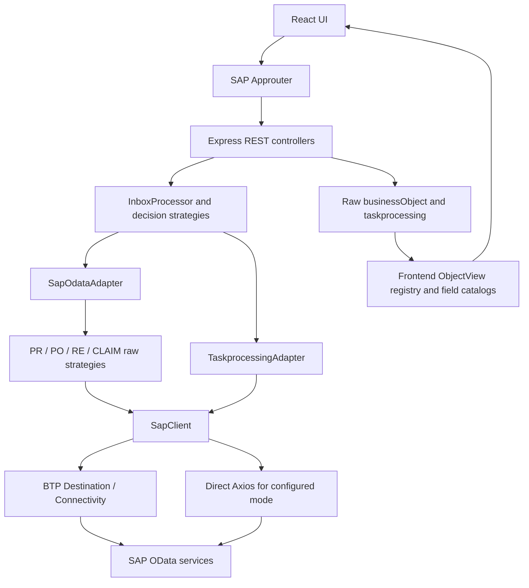

# System Architecture Overview

> **Owner:** Project Team | **Last Updated:** 2026-10-20 | **Status:** Active

CNMA Approval is a CAP Node.js / Express BFF with React 18, Vite, TypeScript and `@cnma/react-ui`.
It orchestrates SAP workflow tasks without maintaining a local business database.

## Responsibilities

- [server.ts](../../../srv/server.ts) mounts REST at `/api/cnma/APPROVAL_SRV/tasks`, plus health, diagnostics and Swagger UI.
- [InboxProcessor](../../../srv/lib/processors/inbox-processor.ts) combines raw objects, worklist records and task metadata, and coordinates actions.
- [SapOdataAdapter](../../../srv/lib/integrations/sap-odata-adapter.ts) registers PR, PO, RE and CLAIM strategies extending [BaseRawDetail](../../../srv/lib/integrations/base.ts).
- Strategies use `ODATA_SERVICES.INSTANCE_LIST`, unwrap transport containers and retain SAP property names. The historical backend JSON mapping registry/canonical projection engine is gone.
- [ObjectView.registry.ts](../../../app/cnma_approval_ui/src/renderers/ObjectView.registry.ts), object field/view catalogs and [taskCardView.ts](../../../app/cnma_approval_ui/src/renderers/core/taskCardView.ts) own display layouts and worklist chips.
- [service.cds](../../../srv/service.cds) and [service.ts](../../../srv/service.ts) expose CAP notification actions alongside REST.

| Object | Header | Category |
| --- | --- | --- |
| PR | `CNMA_PRHEADER` | `BUS2105` |
| PO | `CNMA_POHEADER` | `BUS2012` |
| RE | `CNMA_RESVHEADER` | `ZBUS2093` |
| CLAIM | `CNMA_CLAIMHEADER` | `CLAIM` |

CLAIM header keys additionally include `ApproverNumber`. Aliases are defined in object strategies and the resolver.

## Runtime boundaries

Approuter authenticates deployed API traffic and forwards tokens. The custom BFF Passport middleware depends on XSUAA credentials and production/`ENABLE_JWT_AUTH`.
CAP mocked authentication does not provide mocked business objects. See [configuration](../04-reference/01-configuration.md), [API reference](../02-implementation/03-backend-bff-endpoints.md), [renderer architecture](04-config-driven-mapping.md), and [cache behavior](03-caching-strategy.md).
