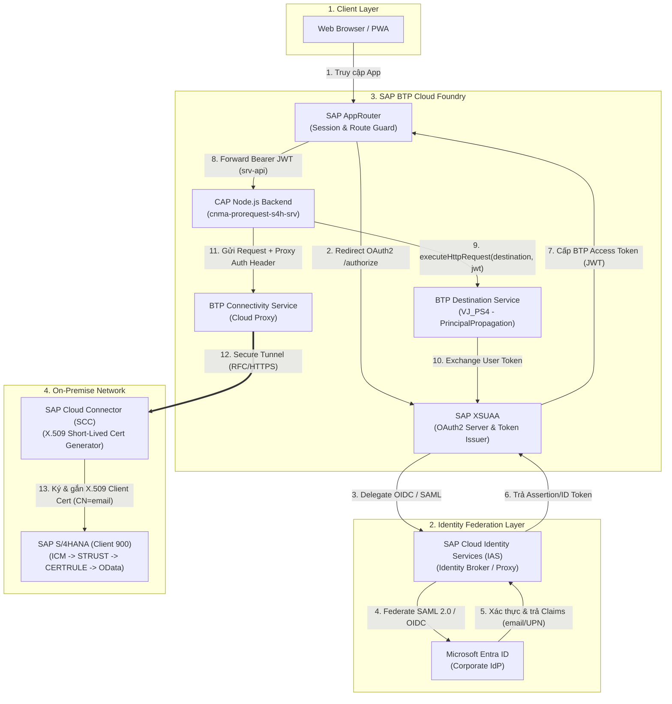
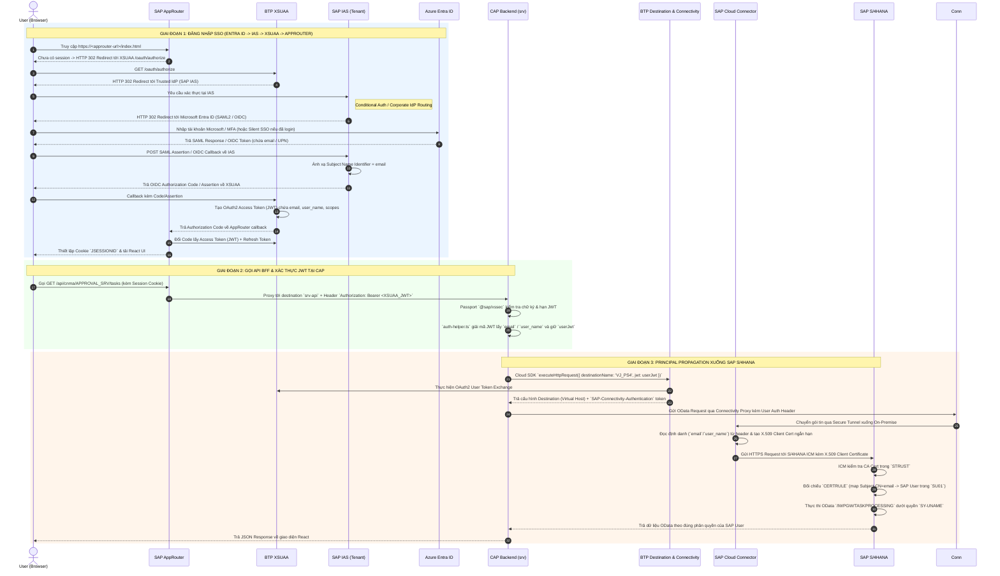

# Luồng Đăng nhập SSO (Azure Entra ID → SAP IAS → BTP) & Principal Propagation xuống SAP S/4HANA

> **Tài liệu Kiến trúc & Cấu hình Chi tiết**  
> **Dự án:** CNMA Approval (`cnma_prorequest_s4h`)  
> **Phạm vi:** End-to-End Authentication (Azure Entra ID ↔ SAP IAS ↔ SAP BTP XSUAA/AppRouter ↔ CAP BFF) & Principal Propagation (BTP Destination ↔ Connectivity ↔ Cloud Connector ↔ SAP S/4HANA)

---

## 1. Tổng quan Kiến trúc (High-Level Overview)

Trong kiến trúc SAP BTP hiện đại kết hợp với hệ thống định danh doanh nghiệp (**Microsoft Entra ID / Azure AD**) và hệ thống lõi **SAP S/4HANA On-Premise**, luồng xác thực được chia làm **2 chặng chính**:

1. **Chặng 1 — Inbound SSO Federation (Xác thực người dùng lên Cloud):**
   Người dùng đăng nhập một lần (Single Sign-On) bằng tài khoản công ty trên **Microsoft Entra ID**. **SAP Cloud Identity Services (IAS)** đóng vai trò là *Identity Broker (Proxy)* đứng giữa để liên kết (federate) với Entra ID và cấp phát định danh cho **SAP BTP (XSUAA / AppRouter)**.
2. **Chặng 2 — Outbound Principal Propagation (Truyền định danh từ Cloud xuống SAP S/4HANA):**
   Từ JWT Token của người dùng tại tầng **CAP Backend (`srv`)**, hệ thống gọi **BTP Destination Service** kết hợp **Connectivity Service** và **SAP Cloud Connector (SCC)**. Cloud Connector sẽ chuyển đổi định danh trong JWT thành một **chứng chỉ số ngắn hạn (Short-lived X.509 Client Certificate)** để đăng nhập thẳng vào **SAP S/4HANA** dưới đúng tài khoản SAP (`SY-UNAME`) của người dùng đó mà **không cần mật khẩu SAP**.



---

## 2. Chi tiết Luồng Hoạt động (End-to-End Sequence Flow)

### 2.1 Sơ đồ Tuần tự Chi tiết (Sequence Diagram)



---

### 2.2 Giải thích chi tiết từng giai đoạn

#### Giai đoạn 1: Liên kết định danh (Federation) Azure Entra ID ↔ SAP IAS ↔ BTP XSUAA
* **Tại sao không nối trực tiếp BTP XSUAA vào Azure Entra ID mà đi qua SAP IAS?**
  Theo kiến trúc chuẩn của SAP (SAP Reference Architecture), **SAP IAS** làm trung tâm quản trị định danh duy nhất cho toàn bộ hệ sinh thái SAP (BTP, SuccessFactors, S/4HANA Cloud, WorkZone, Mobile). Khi nối Entra ID vào IAS một lần, mọi subaccount và ứng dụng SAP đều hưởng lợi từ:
  * **Conditional Authentication**: Phân luồng người dùng nội bộ (có đuôi `@company.com` đẩy sang Entra ID) và đối tác/nhà cung cấp (xác thực trực tiếp trên IAS).
  * **Chuẩn hóa Claims / Subject Name Identifier**: Đảm bảo trường `email` hoặc `Login Name` luôn nhất quán trước khi phát xuống XSUAA.
  * **Hỗ trợ đồng thời Web (XSUAA) và Mobile Native (Direct IAS OIDC)**: Trong dự án này ([`mta.yaml`](file:///d:/learning/test/cnma_approval/mta.yaml#L221-L231)), dịch vụ `identity` được cấu hình `xsuaa-cross-consumption: true`, cho phép cả ứng dụng Mobile dùng OIDC trực tiếp với IAS lẫn ứng dụng Web đi qua AppRouter/XSUAA.

#### Giai đoạn 2: AppRouter giữ Session & chuyển tiếp JWT xuống CAP
* Trình duyệt chỉ giao tiếp với **AppRouter** bằng `HttpOnly` session cookie, tuyệt đối không lưu Access Token dưới trình duyệt.
* Khi React gọi `/api/cnma/APPROVAL_SRV/tasks`, AppRouter khớp route trong [`app/router/xs-app.json`](file:///d:/learning/test/cnma_approval/app/router/xs-app.json#L44-L48), tự động đính kèm `Authorization: Bearer <XSUAA_JWT>` và đẩy xuống CAP nhờ cấu hình `forwardAuthToken: true` trong [`mta.yaml`](file:///d:/learning/test/cnma_approval/mta.yaml#L63-L69).
* Tại CAP Backend:
  * Middleware Passport (`XssecPassportStrategy` trong [`srv/server.ts`](file:///d:/learning/test/cnma_approval/srv/server.ts#L95-L105)) xác thực chữ ký số của JWT với XSUAA.
  * Hàm [`resolveIdentity()`](file:///d:/learning/test/cnma_approval/srv/lib/utils/auth-helper.ts#L112-L137) trong `auth-helper.ts` trích xuất `userJwt` và giải mã payload để lấy `email` / `user_name`.

#### Giai đoạn 3: Cơ chế Principal Propagation qua Destination & Cloud Connector
Đây là phần quan trọng nhất để SAP S/4HANA biết chính xác ai đang thao tác mà không dùng tài khoản kỹ thuật (Technical User) cố định:
1. **SAP Cloud SDK (`executeHttpRequest`)**:
   Trong [`SapClient`](file:///d:/learning/test/cnma_approval/srv/lib/integrations/sap-client.ts#L194-L201), backend truyền `{ destinationName: 'VJ_PS4', jwt: effectiveJwt }`.
2. **Destination Service & Token Exchange**:
   Cloud SDK liên hệ BTP Destination Service, gửi kèm `effectiveJwt` của người dùng. Vì Destination `VJ_PS4` được cấu hình `Authentication: PrincipalPropagation` và `ProxyType: OnPremise`, Destination Service kết hợp với XSUAA sinh ra header xác thực proxy: `SAP-Connectivity-Authentication: Bearer <exchange_token>`.
3. **Connectivity Service & Cloud Connector (SCC)**:
   Request đi qua Connectivity Proxy (`connectivity` service instance) xuyên qua đường truyền bảo mật (TLS Tunnel) xuống **SAP Cloud Connector** đặt tại mạng nội bộ (On-Premise).
4. **Sinh chứng chỉ X.509 ngắn hạn (Short-lived X.509 Certificate)**:
   Cloud Connector giải mã `SAP-Connectivity-Authentication`, lấy thông tin định danh người dùng (ví dụ `email = user@company.com`), sau đó dùng **CA Certificate nội bộ của SCC** ký tức thời một **X.509 Client Certificate** có `Subject CN = user@company.com` (chỉ có hiệu lực vài phút).
5. **Ánh xạ User tại SAP S/4HANA (`STRUST` + `CERTRULE`)**:
   Cloud Connector mở kết nối HTTPS tới S/4HANA ICM và trình X.509 Client Certificate này. S/4HANA kiểm tra tính hợp lệ của chứng chỉ qua `STRUST`, rồi dùng quy tắc trong transaction `CERTRULE` để tìm bản ghi người dùng trong bảng `USR21`/`ADR6` (`SU01`) có địa chỉ Email khớp với `CN` của chứng chỉ. Khi khớp, S/4HANA khởi tạo phiên làm việc dưới đúng `SY-UNAME` của người dùng đó.

---

## 3. Các Cấu hình Liên quan theo Từng Tầng (Configuration Guide)

Để luồng trên hoạt động thông suốt từ đầu đến cuối, cần cấu hình đồng bộ ở **5 tầng**:

---

### Tầng 1: Microsoft Entra ID (Azure AD) & SAP IAS

#### 1.1 Trên Microsoft Entra ID (Azure Portal)
1. Vào **Microsoft Entra ID** → **Enterprise Applications** → Tạo ứng dụng (hoặc dùng gallery template **SAP Cloud Identity Services**).
2. Vào mục **Single sign-on** → Chọn **SAML** (hoặc OpenID Connect):
   * **Identifier (Entity ID)** và **Reply URL (Assertion Consumer Service URL)**: Lấy từ file Metadata của SAP IAS (`https://<ias-tenant>.accounts.ondemand.com/saml2/metadata`).
3. **Attributes & Claims**:
   * Đảm bảo trả về `Unique User Identifier (Name ID)` là `user.mail` hoặc `user.userprincipalname`.
   * Các claim bổ sung: `email` (`user.mail`), `first_name` (`user.givenname`), `last_name` (`user.surname`), `Groups` (nếu phân quyền theo Azure Security Group).
4. Tải **Federation Metadata XML** từ Entra ID để import vào SAP IAS.

#### 1.2 Trên SAP Cloud Identity Services (IAS Admin Console)
1. **Tạo Corporate Identity Provider**:
   * Vào **Identity Providers** → **Corporate Identity Providers** → **Create** (ví dụ: `Azure-Entra-ID`).
   * Chọn **Identity Provider Type**: `Microsoft ADFS / Entra ID (SAML 2.0)` và upload file **Metadata XML** từ Entra ID.
2. **Cấu hình Application cho BTP Subaccount**:
   * Vào **Applications & Resources** → **Applications** → Chọn ứng dụng đại diện cho BTP Subaccount (`SAP BTP Subaccount <xxx>`).
   * Trong **Subject Name Identifier**: Chọn **Basic Configuration** → Nguồn `Corporate Identity Provider`, giá trị là **E-Mail** (hoặc `mail` / `Login Name` tùy theo thuộc tính dùng để map dưới SAP S/4HANA).
   * Trong **Default Name ID Format**: Chọn `E-Mail`.
   * Trong **Conditional Authentication**: Đặt Default Authenticating Identity Provider trỏ về `Azure-Entra-ID` vừa tạo (để user không bị dừng ở màn hình login của IAS mà chuyển thẳng sang Microsoft).

> [!IMPORTANT]
> Giá trị **Subject Name Identifier** được cấu hình ở IAS sẽ trở thành claim `user_name` / `email` bên trong XSUAA JWT, và chính là giá trị mà Cloud Connector đưa vào chứng chỉ X.509 để map sang `SU01` dưới SAP S/4HANA.

---

### Tầng 2: SAP BTP Cockpit (Trust, XSUAA & Destination)

#### 2.1 Trust Configuration (BTP Subaccount → Security → Trust Configuration)
* Thiết lập Trust giữa BTP Subaccount và SAP IAS Tenant (khuyến nghị dùng **Establish Trust** tự động qua OIDC hoặc SAML).
* Đảm bảo trạng thái **Active** và bật **Available for User Logon**.
* Phân quyền **Role Collections** (`CNMA_PROREQUEST_S4H-User`, `CNMA_PROREQUEST_S4H-Admin`) cho người dùng hoặc map tự động theo Group từ IAS/Entra ID.

#### 2.2 Cấu hình Destination kết nối S/4HANA (BTP Subaccount → Connectivity → Destinations)
Tạo Destination có tên trùng với biến môi trường `SAP_TASK_DESTINATION` (trong dự án hiện tại là `VJ_PS4`):

| Thuộc tính (Property) | Giá trị (Value) | Giải thích |
| :--- | :--- | :--- |
| `Name` | `VJ_PS4` | Khớp với `SAP_TASK_DESTINATION` trong [`mta.yaml`](file:///d:/learning/test/cnma_approval/mta.yaml#L33) |
| `Type` | `HTTP` | Giao thức HTTP/HTTPS |
| `URL` | `http://<virtual-host>:<virtual-port>` | Địa chỉ Virtual Host khai báo trong Cloud Connector (không phải IP thật của S/4) |
| `ProxyType` | `OnPremise` | Bắt buộc để đi qua Connectivity Service & Cloud Connector |
| `Authentication` | `PrincipalPropagation` | Bắt buộc để truyền định danh user xuống S/4HANA |
| `sap-client` *(Additional Property)* | `900` | SAP Client mặc định |
| `HTML5.DynamicDestination` *(Additional)* | `true` | Cho phép HTML5/AppRouter nhận diện |

---

### Tầng 3: Cấu hình trong Source Code Dự án (`cnma_prorequest_s4h`)

Dự án đã được cấu hình sẵn các thành phần sau:

#### 3.1 Cấu hình XSUAA trong [`xs-security.json`](file:///d:/learning/test/cnma_approval/xs-security.json)
* Khai báo `scopes` (`$XSAPPNAME.user`, `$XSAPPNAME.admin`) và `role-collections`.
* Trong `oauth2-configuration.grant-types` ([`xs-security.json`](file:///d:/learning/test/cnma_approval/xs-security.json#L54-L59)), bắt buộc phải có `user_token` và `urn:ietf:params:oauth:grant-type:jwt-bearer` để hỗ trợ OAuth2 User Token Exchange khi thực hiện Principal Propagation:
  ```json
  "grant-types": [
    "authorization_code",
    "client_credentials",
    "user_token",
    "urn:ietf:params:oauth:grant-type:jwt-bearer"
  ]
  ```

#### 3.2 Cấu hình Module & Service Bindings trong [`mta.yaml`](file:///d:/learning/test/cnma_approval/mta.yaml)
* **Module `cnma-prorequest-s4h-approuter`** ([`mta.yaml`](file:///d:/learning/test/cnma_approval/mta.yaml#L52-L70)):
  * Bind với `cnma-prorequest-s4h-auth` (XSUAA).
  * Khai báo destination `srv-api` trỏ về CAP Backend với **`forwardAuthToken: true`** để chuyển tiếp JWT của người dùng xuống CAP.
  * `DYNAMIC_IDENTITY_PROVIDER: true` và `SESSION_TIMEOUT: 28800`.
* **Module `cnma-prorequest-s4h-srv` (CAP Backend)** ([`mta.yaml`](file:///d:/learning/test/cnma_approval/mta.yaml#L24-L48)):
  * Biến môi trường:
    ```yaml
    properties:
      SAP_USE_DESTINATION: "true"
      SAP_TASK_DESTINATION: "VJ_PS4"
      SAP_TASK_CLIENT: "900"
    ```
  * Bind đầy đủ 4 dịch vụ cốt lõi:
    * `cnma-prorequest-s4h-auth` (`xsuaa`)
    * `cnma-prorequest-s4h-identity` (`identity` với `xsuaa-cross-consumption: true`)
    * `cnma-prorequest-s4h-destination` (`destination`)
    * `cnma-prorequest-s4h-connectivity` (`connectivity`)

#### 3.3 Cấu hình Định tuyến AppRouter trong [`app/router/xs-app.json`](file:///d:/learning/test/cnma_approval/app/router/xs-app.json)
* Mọi request vào `/api/(.*)` và `/odata/v4/(.*)` đều yêu cầu `"authenticationType": "xsuaa"` và đẩy sang `"destination": "srv-api"`.

#### 3.4 Xử lý Token & Gọi Destination trong CAP Backend
1. **Xác thực JWT tại [`srv/server.ts`](file:///d:/learning/test/cnma_approval/srv/server.ts#L94-L108)**:
   Sử dụng `@sap/xssec` (`XssecPassportStrategy`) gắn vào route `/api/cnma/APPROVAL_SRV/tasks`.
2. **Trích xuất User & JWT tại [`srv/lib/utils/auth-helper.ts`](file:///d:/learning/test/cnma_approval/srv/lib/utils/auth-helper.ts#L10-L49)**:
   Hàm [`extractJwtFromRequest()`](file:///d:/learning/test/cnma_approval/srv/lib/utils/auth-helper.ts#L10-L49) lấy Bearer token từ các header `authorization`, `x-approuter-authorization`, `x-forwarded-access-token`, hoặc `cds.user.jwt`.
3. **Truyền JWT sang SAP Cloud SDK tại [`srv/lib/integrations/sap-client.ts`](file:///d:/learning/test/cnma_approval/srv/lib/integrations/sap-client.ts#L194-L201)**:
   ```typescript
   const response = await executeHttpRequest(
       { destinationName: this.destinationName, jwt: effectiveJwt },
       {
           method: 'get',
           url: requestUrl,
           headers: this.getRequestHeaders(sapUser)
       }
   );
   ```

---

### Tầng 4: SAP Cloud Connector (SCC)

Trên giao diện quản trị SAP Cloud Connector (`https://<scc-host>:8443`):

1. **Kết nối Subaccount**:
   * Thêm BTP Subaccount vào SCC. Kiểm tra trạng thái Tunnel **Connected**.
   * Trong tab **Cloud To On-Premise** → **Principal Propagation**, bấm **Synchronize** để đồng bộ danh sách Trusted IdP từ BTP Subaccount xuống SCC.
2. **Cấu hình Chứng chỉ cho Principal Propagation** (Menu **Configuration** → **OnPremise**):
   * **System Certificate**: Tạo hoặc import chứng chỉ cho bản thân SCC.
   * **CA Certificate**: Tạo hoặc import chứng chỉ CA dùng để ký các chứng chỉ X.509 ngắn hạn cho người dùng. *(Xuất file `.crt` / `.cer` của CA Certificate này để đem import vào `STRUST` của S/4HANA)*.
   * **Principal Propagation → Subject Pattern**:
     Cấu hình mẫu Subject cho chứng chỉ X.509 ngắn hạn, ví dụ:
     * `CN=${email}` (nếu map theo Email)
     * Hoặc `CN=${name}` (nếu `name` trong token đã là Email hoặc SAP User ID).
   * Có thể bấm nút **Generate Sample Certificate** trên SCC để xuất ra 1 file `.cer` mẫu phục vụ cấu hình nhanh dưới S/4HANA (`CERTRULE`).
3. **Khai báo Access Control (Cloud To On-Premise)**:
   * **Backend Type**: `ABAP System`
   * **Protocol**: **`HTTPS`** *(Bắt buộc phải là HTTPS thì SCC mới gửi kèm X.509 Client Certificate sang S/4HANA ICM được; HTTP thường sẽ không truyền được X.509 cert)*.
   * **Internal Host / Port**: IP/Hostname thật và cổng HTTPS ICM của S/4HANA (ví dụ `s4hana.internal.corp:44300`).
   * **Virtual Host / Port**: Tên ảo khớp với URL trên BTP Destination `VJ_PS4`.
   * **Principal Type**: **`X.509 Certificate (General Usage)`** hoặc `X.509 Certificate (Strict Usage)`.
   * **Resources Accessible**: Cho phép đường dẫn `/sap/opu/odata/` (`Path and all sub-paths`).

---

### Tầng 5: SAP S/4HANA On-Premise (Cấu hình Basis)

Đội ngũ SAP Basis cần cấu hình 4 bước sau trên hệ thống S/4HANA:

#### 5.1 Tham số Hệ thống (`RZ10` / `RZ11`)
Đảm bảo các tham số ICM và Login được thiết lập:
```ini
# Cho phép ICM nhận X.509 Client Certificate (1 = allow, 2 = required)
icm/HTTPS/verify_client = 1

# Bật tính năng ánh xạ chứng chỉ dựa trên quy tắc (Rule-based mapping qua T-Code CERTRULE)
login/certificate_mapping_rulebased = 1
```
*(Nếu dùng SAP Web Dispatcher đứng giữa SCC và S/4HANA, cần cấu hình thêm `icm/trusted_reverse_proxy_<x>` để S/4 tin tưởng header chứng chỉ do Web Dispatcher chuyển tiếp).*

#### 5.2 Tin cậy CA Certificate của Cloud Connector (`STRUST`)
1. Vào transaction **`STRUST`**.
2. Chọn nhánh **SSL server Standard** (nhấp đúp vào PSE của hệ thống).
3. Ở phần **Certificate**, bấm **Import certificate** và chọn file **CA Certificate** đã xuất từ SAP Cloud Connector (ở Tầng 4 - Mục 2).
4. Bấm **Add to Certificate List** và **Save**.
5. Khởi động lại ICM (qua `SMICM` → Administration → ICM → Restart → Yes) để nhận diện CA mới.

#### 5.3 Thiết lập Quy tắc Ánh xạ User (`CERTRULE`)
1. Vào transaction **`CERTRULE`** (Rule-Based Certificate Mapping).
2. Bấm chuyển sang chế độ **Edit**.
3. Có thể bấm **Import Certificate** và chọn file **Sample Certificate** xuất từ Cloud Connector để hệ thống tự nhận diện **Issuer**.
4. Tạo một **Rule** mới cho Issuer của Cloud Connector CA:
   * **Subject Attribute**: Chọn `CN` (Common Name - nơi chứa `email` hoặc `user_name`).
   * **Login As**: Chọn **`Email`** (nếu `CN` chứa địa chỉ email công ty và muốn map với trường E-Mail trong `SU01`) hoặc **`User ID`** (nếu `CN` chứa trực tiếp mã SAP User).
5. Bấm **Save**. *(Nếu không dùng `CERTRULE` theo quy tắc chung, có thể map thủ công từng user trong bảng **`USREXTID`** với Type = `DN`).*

#### 5.4 Kiểm tra Dữ liệu Người dùng (`SU01`) & Dịch vụ OData (`/IWFND/MAINT_SERVICE`)
* Trong **`SU01`**: Tài khoản SAP của người dùng phê duyệt phải có trường **E-Mail Address** trùng khớp (không phân biệt hoa thường nếu chuẩn hóa) với email trên Microsoft Entra ID, tài khoản không bị khóa và có đầy đủ Role chạy Workflow/OData.
* Trong **`/IWFND/MAINT_SERVICE`** và **`SICF`**: Các OData service phục vụ phê duyệt (như `/IWPGW/TASKPROCESSING;v=2` và các custom `CNMA_*` service) đã được kích hoạt.

---

## 4. Bảng Chẩn đoán & Xử lý Lỗi (Troubleshooting Matrix)

Khi kiểm thử luồng End-to-End, bạn có thể khoanh vùng lỗi nhanh theo từng triệu chứng sau:

| Triệu chứng / Mã lỗi | Chặng xảy ra lỗi | Nguyên nhân phổ biến | Cách kiểm tra & khắc phục |
| :--- | :--- | :--- | :--- |
| Vòng lặp Redirect khi mở Web hoặc lỗi SAML trên IAS | **Entra ID ↔ IAS ↔ XSUAA** | Sai Reply URL / Entity ID giữa Entra ID và IAS, hoặc chứng chỉ SAML Signing hết hạn. | Kiểm tra **Troubleshooting Logs** trên IAS Admin Console và SAML Tracer trên trình duyệt. |
| Đăng nhập thành công nhưng vào App bị **403 Forbidden** | **XSUAA ↔ AppRouter** | User chưa được gán Role Collection trên BTP (`CNMA_PROREQUEST_S4H-User`). | Vào BTP Cockpit → Security → Users / Role Collections gán quyền, sau đó đăng xuất & đăng nhập lại để làm mới JWT. |
| CAP Backend nhận user là `anonymous` hoặc `MOCK_USER` | **AppRouter ↔ CAP (`srv`)** | Thiếu `forwardAuthToken: true` ở `srv-api`, hoặc truy cập thẳng URL của `srv` thay vì URL của `approuter`. | Kiểm tra [`mta.yaml`](file:///d:/learning/test/cnma_approval/mta.yaml#L68), mở đúng URL của AppRouter và gọi endpoint chẩn đoán `/api/cnma/APPROVAL_SRV/tasks/debug/jwt`. |
| Lỗi `Failed to build headers` hoặc `Token exchange failed` tại CAP | **CAP ↔ Destination Service** | JWT truyền vào không phải User Token của XSUAA/IAS hợp lệ, hoặc `xs-security.json` thiếu grant type `user_token` / `jwt-bearer`. | Kiểm tra `effectiveJwt` trong [`sap-client.ts`](file:///d:/learning/test/cnma_approval/srv/lib/integrations/sap-client.ts#L90-L99) và đảm bảo `xs-security.json` đã cập nhật trên BTP. |
| Lỗi **502 Bad Gateway / 503 Service Unavailable** khi gọi S/4 | **Connectivity ↔ Cloud Connector** | Cloud Connector bị ngắt kết nối, sai Virtual Host/Port, hoặc chưa cấp quyền Resource `/sap/opu/odata/`. | Mở giao diện SCC (`:8443`), kiểm tra trạng thái Subaccount Tunnel và mục **Access Control**. |
| S/4HANA trả về **401 Unauthorized** dù đi qua SCC thành công | **Cloud Connector ↔ S/4HANA** | 1. Giao thức trong SCC đang để `HTTP` thay vì `HTTPS`.<br>2. S/4 chưa import CA Cert của SCC vào `STRUST`.<br>3. `CERTRULE` chưa khớp hoặc `SU01` thiếu Email. | 1. Đổi SCC sang `HTTPS` và Principal Type = `X.509 Certificate`.<br>2. Bật Trace trên SCC (**Log And Trace Files**) để xem X.509 Subject CN đã sinh ra là gì.<br>3. Bật ICM Trace (`SMICM`, trace level 2/3) trên S/4HANA để xem lý do từ chối chứng chỉ. |
| S/4HANA trả về **403 Forbidden** (CSRF hoặc thiếu quyền SAP) | **S/4HANA Authorization** | Đã map đúng SAP User (`SY-UNAME`), nhưng user đó thiếu Role/Authorization Object trong SAP. | Chạy transaction **`SU53`** hoặc **`/IWFND/ERROR_LOG`** trên S/4HANA ngay sau khi gọi API bị lỗi để xem thiếu quyền gì. |

---

## 5. Tài liệu Tham khảo Nội bộ trong Dự án

* [02-auth-security.md](file:///d:/learning/test/cnma_approval/docs/technical/01-architecture/02-auth-security.md) — Kiến trúc bảo mật và biên xác thực trong dự án.
* [web_approuter_sso_guide.md](file:///d:/learning/test/cnma_approval/docs/plans/web_approuter_sso_guide.md) — Hướng dẫn cấu hình SSO cho React Web qua AppRouter, XSUAA và IAS.
* [cap-react-local-hybrid-principal-propagation-guide.md](file:///d:/learning/test/cnma_approval/docs/plans/cap-react-local-hybrid-principal-propagation-guide.md) — Hướng dẫn chạy Hybrid Local với BTP Destination Principal Propagation.
