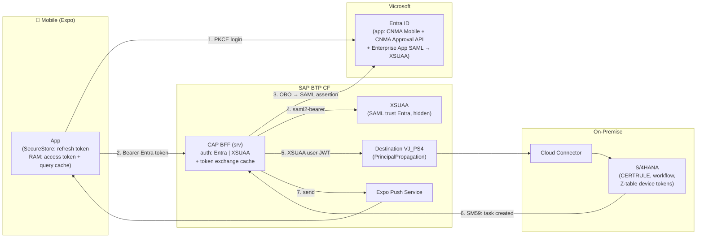
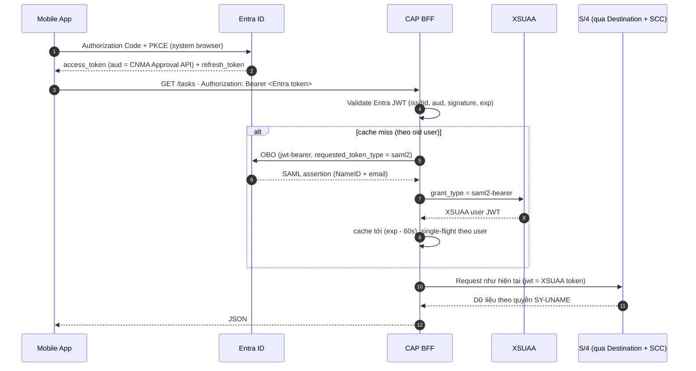
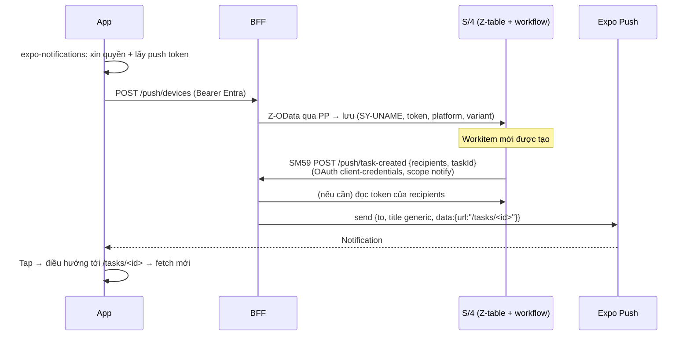

# CNMA Approval Mobile (Expo / React Native) — Architecture & Implementation Guide

> **Owner:** Project Team | **Last Updated:** 2026-10-29 | **Status:** Draft — chờ PoC auth (Phase 0)
>
> **Target stack:** Expo SDK 58 (React Native 0.88, New Architecture only) · TypeScript · Expo Router · `@expo/ui` · Reanimated 4 · TanStack Query v5 · CAP BFF hiện có (`srv/`)
>
> Guide này được xây theo best practices của các Expo skills: `expo-project-structure`, `expo-design-system`, `expo-router`, `expo-native-ui`, `expo-ui`, `expo-data-fetching`, `expo-animation`, `expo-dev-client`, `eas-app-stores`, `eas-update`, `eas-observe`, `eas-simulator`, `expo-module`. Phần tablet, màn hình gập, biến thể build và push deep link lấy từ docs và blog chính thức của Expo (link ở cuối). Khi code, luôn đọc docs **theo đúng SDK đã pin** (ví dụ `https://docs.expo.dev/versions/v58.0.0/...`), không đọc `latest`.
>
> **Tài liệu liên quan:** [02-approval-core-refactor.md](./02-approval-core-refactor.md) (làm sạch renderer chứng từ, Phase 1 — đã xong) · [03-store-review-checklist.md](./03-store-review-checklist.md) (Apple/Google review, trước mỗi lần nộp)

---

## 0. Các quyết định đã chốt

| Chủ đề | Quyết định | Lý do |
|---|---|---|
| Mục tiêu | App native cho mobile, giữ đăng nhập lâu, mở nhanh, UI mượt và đẹp hơn web | Web/PWA hay mất session (approuter session trong RAM, IAS token policy, iframe WorkZone) |
| Phạm vi màn hình | **Home · Inbox (My Tasks) · Approved · Dashboard** giống web, kèm Task Detail, Decision và Account | Giữ cùng tính năng với web. Notification Console (admin, desktop) **không** đưa lên mobile |
| Ngôn ngữ | **100% TypeScript.** Không viết Swift/Kotlin trừ khi thiếu module (khi đó dùng Expo Modules API) | Mọi nhu cầu native trong guide đều có module Expo sẵn |
| Đăng nhập | **Login thẳng Microsoft Entra ID, không qua IAS** | Team không muốn quản lý IAS |
| Principal Propagation | BFF đổi token: **Entra → OBO (SAML assertion) → XSUAA `saml2-bearer` → Destination `VJ_PS4` → SCC → S/4** | Cloud Connector chỉ nhận user token do XSUAA của subaccount cấp |
| Trust BTP | Thêm **1 SAML trust với Entra**, `Available for User Logon = No`, không role collection | Chỉ để XSUAA nhận diện user Entra. Trust IAS của web giữ nguyên |
| Phân quyền | Hoàn toàn ở SAP (PP → `SY-UNAME`) | App không có role |
| Offline | **Không hỗ trợ.** Không có offline queue | Dữ liệu SAP phải mới nhất, quyết định duyệt không được gửi trễ |
| Cache dữ liệu nghiệp vụ | **Chỉ trong RAM.** Không persist chứng từ xuống máy | Yêu cầu luôn lấy dữ liệu mới |
| Biometric | Chưa làm | Chưa chứng minh được giá trị |
| Push | ABAP gọi BFF qua **SM59**, device token lưu ở **Z-table trên S/4**. Bấm vào push mở đúng task | BTP hiện không có DB. ABAP biết người nhận |
| Attachment | Tải native thẳng ra file, xem bằng viewer của OS | Web đang buffer cả file ở BE và giữ blob trong RAM JS |
| Biến thể build | **3 app variants cài song song:** Dev · QAS · PRD | Dev và tester test trên máy thật mà không đụng bản người dùng |
| Thiết bị | iPhone, Android phone, **iPad, Android tablet, máy gập (iPhone Duo, Android foldables)**. Layout **mở rộng ra, không đổi thiết kế** | Theo khuyến nghị của Apple/Expo cho thiết bị gập |
| Điều hướng | NativeTabs (4 tab), **không dùng drawer** | 4 đích đến chính thì HIG và M3 đều khuyên dùng tabs. Tabs tự thích ứng thành sidebar hoặc rail |
| Phân phối | Nội bộ: Android APK (EAS internal) · iOS TestFlight (pilot) → Unlisted App Store / Apple Business Manager | Chỉ dùng trong công ty |

---

## 1. Kiến trúc tổng thể



**Nguyên tắc:**
- Mobile gọi thẳng URL `srv-api` (route `/api/cnma/APPROVAL_SRV/tasks`), **không đi qua approuter**. Không cookie, không CSRF.
- Web giữ nguyên luồng approuter → IAS → Entra.
- Từ bước 5 trở đi, BFF chạy **y hệt hiện tại**: `SapClient` nhận một XSUAA user JWT.

---

## 2. Authentication & Session

### 2.1 Luồng token



### 2.2 Cấu hình cần có

| Nơi | Đối tượng | Cấu hình chính |
|---|---|---|
| Entra | App registration **CNMA Mobile** | Public client. Redirect URI **mỗi biến thể một cái**: `cnmaapproval-dev://auth`, `cnmaapproval-qas://auth`, `cnmaapproval://auth`. Xin scope `api://<api-app-id>/access_as_user` + `offline_access` |
| Entra | App registration **CNMA Approval API** | Expose scope `access_as_user`, cấp quyền cho CNMA Mobile, có client secret hoặc cert (dùng cho OBO) |
| Entra | **Enterprise App SAML → XSUAA subaccount** | Import SAML metadata của subaccount (nút *Download SAML Metadata*). NameID và attribute `email` **phải ra cùng giá trị** với claim `email` của token web hiện tại |
| BTP | Trust Configuration → **Add SAML Trust** (origin ví dụ `entra-mobile`) | `Available for User Logon = No`, `Create Shadow Users = On`, **không** bật *Default for Noninteractive Logon*, không role collection |
| BFF | Env/secret mới | `ENTRA_TENANT_ID`, `ENTRA_API_CLIENT_ID`, `ENTRA_API_CLIENT_SECRET` (hoặc cert), scope OBO tới Enterprise App SAML. Lưu bằng user-provided service, **không** để trong `mta.yaml` |

**Ảnh hưởng tới web:** không có. Trust `sap.custom` (IAS) không đổi. Vì trust mới có `Available for User Logon = No` nên XSUAA không hiện trang chọn IdP. Entity ID của Enterprise App mới (XSUAA) khác app SAML hiện có (IAS), nên không xung đột trên Entra.

### 2.3 Thay đổi ở BFF

1. **Auth middleware chọn theo issuer** (mount ở `/api/cnma/APPROVAL_SRV/tasks`, thay cho việc chỉ có `passport.authenticate('JWT')` như [server.ts](../../../srv/server.ts)):
   - `iss = https://login.microsoftonline.com/<tid>/v2.0`: đi nhánh Entra (validate qua JWKS, kiểm tra `tid` và `aud`), sau đó đổi sang XSUAA token rồi **ghi đè `Authorization`** bằng XSUAA token. Nhờ vậy `resolveIdentity()` và toàn bộ controller không phải sửa.
   - Còn lại: đi nhánh XSUAA passport như hiện tại (web).
2. **`TokenExchangeService`**: OBO → `saml2-bearer`. Cache theo `oid` (+ `tid`) tới `exp - 60s`, single-flight để nhiều request song song chỉ đổi một lần, không log token.
3. **Bắt buộc trước khi phát hành mobile:** chặn header `x-sap-user` khi `NODE_ENV=production` ([auth-helper.ts:119](../../../srv/lib/utils/auth-helper.ts:119)). Doc [02-auth-security.md](../01-architecture/02-auth-security.md) đã ghi nhận lỗ hổng này.

### 2.4 Phía mobile

- Dùng `expo-auth-session` (Authorization Code + PKCE, trình duyệt hệ thống). Nếu sau này IT bắt buộc Intune hoặc compliant device thì chuyển sang MSAL có broker.
- **Refresh token** lưu trong `expo-secure-store` (Keychain/Keystore, chỉ trên thiết bị này). **Access token chỉ giữ trong RAM.**
- Refresh **chủ động** trước khi hết hạn, mỗi lần `AppState` chuyển sang `active`, và khi gặp 401 (retry một lần, single-flight).
- **Session dài:** refresh token của Entra cho native app mặc định khoảng 90 ngày và gia hạn mỗi lần dùng. Giới hạn thực tế do Conditional Access của IT quyết định (sign-in frequency). Đây là câu hỏi duy nhất cần hỏi Microsoft admin.
- **Logout** (từ màn Account): xoá SecureStore, `queryClient.clear()`, xoá attachment cache, huỷ đăng ký device token push.

### 2.5 PoC (Phase 0): test trước, chưa đụng Entra công ty

| Bước | Việc | Tiêu chí đạt |
|---|---|---|
| 1 | Tạo **Entra tenant miễn phí** (Azure free), tạo 3 app object ở mục 2.2 và một user test | Login PKCE bằng Postman lấy được token |
| 2 | **Subaccount QAS:** Add SAML Trust tới tenant test (`Available for User Logon = No`) | Login web QAS vẫn đi thẳng IAS, không hiện trang chọn IdP |
| 3 | Postman: OBO → SAML assertion → XSUAA `saml2-bearer` | Nhận được XSUAA JWT. Xác nhận `saml2-bearer` vẫn chạy khi trust bị ẩn |
| 4 | So sánh claim `email` / `user_name` của token mới với token web | Giống hệt nhau (tránh lệch UPN với mail) |
| 5 | **S/4 QAS:** user có email trùng user test. Deploy branch PoC của BFF lên QAS (local đang chạy `SAP_USE_DESTINATION=false` nên không test được PP) | `GET /tasks` với Bearer Entra trả đúng task của user |
| 6 | App Expo tối giản (Login + danh sách task), biến thể `development`, chạy dev build trên máy thật | Redirect, refresh, đóng/mở app vẫn còn đăng nhập |

Khi đạt cả 6 bước mới gửi Microsoft admin checklist: 3 app object, các cấu hình kèm theo, và câu hỏi về Conditional Access.

---

## 3. Cấu trúc dự án (Clean Architecture + Expo project structure)

### 3.1 Dùng chung logic với web ("approval-core")

**"approval-core" là tên gọi của phần logic dùng chung, không phải một package riêng.** Hiện chưa có kế hoạch dùng cho app khác, nên **không** tạo `package.json` hay npm workspaces (tránh rủi ro cho `cds build` / `mbt build` của root CAP).

- **Renderer chứng từ** (`app/cnma_approval_ui/src/renderers/`) đã được làm sạch: không phụ thuộc UI, có ESLint chặn ranh giới, có golden test khoá hiển thị. Chi tiết ở [02-approval-core-refactor.md](./02-approval-core-refactor.md).
- Các phần thuần khác sẽ dùng chung theo cùng nguyên tắc khi cần: contracts (`services/inbox/inbox.types|contracts`), query keys (`inboxKeys`), phần chuẩn hoá dữ liệu Dashboard, `locales/`.
- **Khi scaffold mobile:** mobile import trực tiếp các thư mục này qua path alias (ví dụ `@approval-core/renderers` → `../cnma_approval_ui/src/renderers`, khai báo trong `tsconfig` và Metro `watchFolders`), hoặc chuyển chúng ra một thư mục chung như `app/shared/`. Chọn cách cụ thể ở Phase 2.
- **Quy tắc:** phần dùng chung không import `react`, `react-native`, `expo-*`, DOM hay tầng page/component của web.

### 3.2 Cấu trúc app mobile (theo `expo-project-structure`)

```text
app/cnma_approval_mobile/
├── .maestro/                             # E2E flows (YAML)
├── assets/                               # icon/splash cho từng biến thể: icon.png, icon-dev.png, icon-qas.png
├── modules/                              # (để trống) Expo Modules viết bằng Swift/Kotlin — chỉ khi thiếu module
├── plugins/                              # (để trống) config plugin TypeScript cho cấu hình native
├── scripts/
├── src/
│   ├── app/                              # CHỈ chứa routes (mỗi file là một route)
│   │   ├── _layout.tsx                   # Providers + Stack gốc + Stack.Protected (auth gate) + notification observer
│   │   ├── +native-intent.tsx            # Chuẩn hoá và kiểm tra deep link (chỉ nhận /tasks/<id>)
│   │   ├── +not-found.tsx
│   │   ├── sign-in.tsx
│   │   ├── account.tsx                   # formSheet: thông tin user, ngôn ngữ, phiên bản, logout
│   │   ├── filter.tsx                    # formSheet: bộ lọc (Inbox, Dashboard)
│   │   ├── dev-settings.tsx              # Chỉ biến thể dev/QAS: push token, test push, đổi backend non-prod
│   │   └── (tabs)/
│   │       ├── _layout.tsx               # NativeTabs: Home · Inbox · Approved · Dashboard
│   │       └── (home,inbox,approved,dashboard)/   # Stack dùng chung cho 4 tab
│   │           ├── _layout.tsx           # Chọn screen gốc theo segment, header + nút Account
│   │           ├── index.tsx             # Home — route "/" (app luôn phải có route khớp "/")
│   │           ├── inbox.tsx
│   │           ├── approved.tsx
│   │           ├── dashboard.tsx
│   │           └── tasks/
│   │               ├── [id].tsx          # Task detail (push từ mọi tab)
│   │               └── [id]/
│   │                   ├── decision.tsx  # formSheet: comment + Approve/Reject
│   │                   └── attachments/[attId].tsx  # viewer modal
│   ├── screens/                          # Thân màn hình, route chỉ render screen
│   │   ├── home/
│   │   │   ├── index.tsx
│   │   │   ├── summary-header.tsx        # chào + số task chờ duyệt
│   │   │   └── kpi-row.tsx
│   │   ├── inbox/
│   │   │   ├── index.tsx                 # quyết định 1 cột / 2 cột theo window size class
│   │   │   ├── task-row.tsx
│   │   │   └── category-segments.tsx
│   │   ├── dashboard/
│   │   │   ├── index.tsx
│   │   │   ├── status-donut.tsx
│   │   │   ├── category-overview.tsx
│   │   │   └── dashboard-task-row.tsx
│   │   ├── task-detail/
│   │   │   ├── index.tsx
│   │   │   ├── overview-section.tsx      # render CardDefinition từ approval-core
│   │   │   ├── line-items.tsx            # render TableDefinition thành thẻ mở rộng
│   │   │   ├── workflow-section.tsx
│   │   │   └── attachments-section.tsx
│   │   ├── decision/index.tsx
│   │   ├── account/index.tsx
│   │   └── dev-settings/index.tsx
│   ├── components/                       # UI dùng lại ≥ 2 màn hình
│   │   ├── themed-text.tsx
│   │   ├── button.tsx
│   │   ├── task-list-item.tsx            # dùng ở Home (5 task mới nhất), Inbox, Approved
│   │   ├── status-badge.tsx
│   │   ├── amount-text.tsx
│   │   ├── kpi-tile.tsx                  # Home + Dashboard
│   │   ├── empty-state.tsx
│   │   ├── error-state.tsx
│   │   ├── skeleton.tsx
│   │   ├── account-button.tsx            # avatar trên header các tab
│   │   └── adaptive/
│   │       ├── two-pane.tsx              # list + detail khi màn hình rộng
│   │       └── index.ts
│   ├── hooks/
│   │   ├── queries/                      # use-status-counts, use-inbox-query, use-task-detail, use-dashboard...
│   │   ├── use-decision.ts
│   │   └── use-window-class.ts           # compact | medium | expanded
│   ├── lib/                              # Hạ tầng (adapter) — KHÔNG import UI
│   │   ├── config/env.ts                 # cấu hình theo biến thể, có kiểu (đọc từ expo-constants extra)
│   │   ├── auth/                         # entra-auth.ts, token-store.ts, session.ts
│   │   ├── api/                          # http-client.ts (expo/fetch), api-error.ts
│   │   ├── query/                        # query-client.ts, app-state-focus.ts, net-info-online.ts
│   │   ├── push/                         # register-push.ts, notification-observer.ts, pending-link.ts
│   │   └── files/                        # attachment-cache.ts
│   ├── utils/                            # helper thuần + test đặt cạnh (format-*.ts / *.test.ts)
│   ├── theme/                            # Design tokens (mục 4)
│   └── constants.ts
├── app.config.ts                         # dynamic config theo APP_VARIANT (mục 12)
├── eas.json
└── package.json
```

**Vì sao cấu trúc này đúng best practice:**
- `src/app/` chỉ chứa route. Phần thân màn hình nằm ở `screens/`, phần chỉ một màn hình dùng thì đặt cùng thư mục với màn hình đó. Chỉ khi xuất hiện ở ≥ 2 màn hình mới promote lên `components/` (theo `expo-project-structure` và `expo-design-system`).
- **Shared group `(home,inbox,approved,dashboard)`:** cả 4 tab dùng chung một stack layout, nên `tasks/[id]` push được từ bất kỳ tab nào mà không phải lặp route (theo `expo-router`).
- `lib/` không có trong khung mặc định của Expo. Mình thêm vào vì đây là ranh giới clean architecture cho các adapter hạ tầng (auth, api, push, file, config), tách hẳn khỏi UI.
- `modules/` và `plugins/` đặt ở root app (ngoài `src/`), đúng quy ước của Expo cho code native và config plugin.

**Quy tắc phụ thuộc** (enforce bằng ESLint `no-restricted-imports` hoặc dependency-cruiser):

```
app/ (routes) → screens/ → components/ + hooks/ → lib/ + @approval-core/* (alias tới code dùng chung)
                                                theme/ ← components/, screens/
```
- `src/app/` chỉ đọc params và render screen, không chứa logic.
- `screens/*` không import lẫn nhau. Phần dùng chung đưa vào `components/` hoặc `hooks/`.
- `lib/` không import `components/`, `screens/` hay `theme/`.
- Code dùng chung (approval-core) không import `react`, `react-native` hay `expo-*`.
- **Không đặt file `.ios.tsx` / `.android.tsx` trong `src/app/`** (route không hỗ trợ platform extension). Chỉ tách theo nền tảng trong `components/` hoặc `screens/`, và luôn có file mặc định không đuôi nền tảng.
- Đặt tên file theo kebab-case. Style để cuối file. Test đặt cạnh file được test.

---

## 4. Design System, Theme & Liquid Glass (theo `expo-design-system`, `expo-native-ui`)

### 4.1 Nguyên tắc
- **Theo ngôn ngữ của từng nền tảng:** HIG trên iOS, Material 3 trên Android. Không bê Fiori của web sang. Thương hiệu thể hiện qua **một màu accent**, không qua việc tự vẽ lại control.
- **Một nguồn token duy nhất:** `src/theme/`. Không hardcode hex, font size hay spacing ngoài thư mục này.
- **Không dùng NativeWind.** Dùng inline style kết hợp token, đúng khuyến nghị của `expo-native-ui`, và tránh thêm một "hệ thống thứ hai".

### 4.2 Tokens

```text
src/theme/
  colors.ts      # semantic (Color từ expo-router) + brand pairs
  spacing.ts     # 4-pt grid: xs 4 · sm 8 · md 16 · lg 24 · xl 32 · xxl 48 (+12 nếu lặp lại nhiều)
  typography.ts  # ramp theo Apple text styles: largeTitle · title · headline · body · subhead · caption
  radius.ts      # sm 8 · md 12 · lg 16 · full — luôn kèm borderCurve: 'continuous'
  shadows.ts     # boxShadow: card · raised · overlay (không dùng elevation/shadow* legacy)
  motion.ts      # fast 150 · base 250 · slow 400
  layout.ts      # breakpoints: compact < 600 · medium 600–839 · expanded ≥ 840; maxContentWidth
  index.ts
```

### 4.3 Màu & Light/Dark
- **Light/dark tự động** theo hệ thống. Không có công tắc theme trong app ở bản đầu.
- Nền, chữ, separator: dùng **semantic** (`Color.ios.*` / `Color.android.dynamic.*`) để tự thích ứng light/dark và cài đặt accessibility. Trên Android, component render màu semantic phải gọi `useColorScheme()` để re-render khi đổi theme (nhất là khi bật React Compiler).
- **Brand pairs (light/dark)** chỉ gồm: `accent` (`#cc0000` lấy từ `--color-brand` trong [theme.css](../../../app/cnma_approval_ui/src/styles/theme.css), kèm biến thể sáng hơn cho dark mode), `onAccent`, `approve` (xanh), `reject` (đỏ), `warning` (cam, cho trạng thái "In Approving" của Dashboard).
- Accent **cố định** theo thương hiệu. Android không dùng màu động theo hình nền cho accent, chỉ dùng cho bề mặt (surface).
- Brand color được đọc bằng hook (`useBrandColors()`), **không** import vào file token tĩnh. Không truyền `Color`/`PlatformColor` vào style của Reanimated.

**Chữ:** mọi văn bản đi qua `ThemedText variant="…"`. Giữ Dynamic Type (`allowFontScaling` mặc định bật). Số tiền và KPI dùng `fontVariant: ['tabular-nums']` và `selectable`. Số lớn rút gọn (ví dụ 1.4M).

### 4.4 Liquid Glass (iOS 26+)
- **Có sẵn, không phải code** khi dùng component native: NativeTabs, header và toolbar của native stack, `formSheet` có `contentStyle: { backgroundColor: 'transparent' }`.
- **Phần tự làm** (ví dụ thanh hành động nổi khi chọn nhiều task, nút nổi trên Dashboard) dùng `GlassView` của `expo-glass-effect` (`isInteractive` cho nút bấm). **Luôn kiểm tra** `isLiquidGlassAvailable() && isGlassEffectAPIAvailable()`.
- Fallback: iOS < 26 dùng `BlurView tint="systemMaterial"`, Android dùng nền đặc `secondarySystemBackground`. Bọc logic này trong một component `components/glass-surface.tsx`.
- **Glass chỉ cho lớp điều hướng và điều khiển, không cho nội dung** (row, card, KPI). Không animate cường độ blur, chỉ crossfade opacity.

### 4.5 Hợp đồng component
- Mỗi primitive có: `variant` (primary · secondary · ghost · destructive), `size` (sm · md), state (pressed · disabled · loading), `style` được merge **cuối cùng**, và đủ accessibility (role, state, label).
- Dùng **children thay vì thêm nhiều prop nội dung**. Không bọc lại control native (`Switch`, picker, header của stack, `@expo/ui`) chỉ để "đi qua design system".

### 4.6 Tránh "native slop" (rà khi review)

| Lỗi | Thay bằng |
|---|---|
| Modal tự vẽ ở giữa màn hình để nhập comment hoặc chọn filter | Route `formSheet` |
| Mọi thứ đều là card có bóng | Danh sách nhóm theo nền + hairline. Task row là row, không phải card nổi |
| Icon emoji | SF Symbols (`expo-symbols`) trên iOS, Material Symbols trên Android |
| Spinner toàn màn hình | Skeleton có hình giống nội dung thật + 4 trạng thái (mục 7.3) |
| Tiêu đề tự vẽ bằng `<Text>` | Tiêu đề của stack (`Stack.Title`, large title) |
| Khối "Quick Access" trên Home lặp lại tab bar (như bản web) | Bỏ đi, vì tab bar đã là quick access |
| Hero gradient đẩy nội dung xuống | Home mở đầu bằng thông tin hữu ích: số task chờ duyệt và task mới nhất |

---

## 5. Màn hình & Navigation (theo `expo-router`, `expo-ui`)

### 5.1 Information architecture

| Tab | Icon (SF / Material) | Nội dung | API |
|---|---|---|---|
| **Home** (mặc định, route `/`) | `house` / `home` | Lời chào, số task chờ duyệt, KPI (Tổng · Đang duyệt · Đã xong), **5 task mới nhất** kèm "Xem tất cả" → tab Inbox | `GET /status-counts`, `GET /tasks?top=5` |
| **Inbox** (My Tasks) | `tray` / `inbox` | Danh sách chờ duyệt, segment category (All · PR · PO · Reservation · Claim), search, filter, swipe | `GET /tasks?category=&top=20&skip=`, `GET /category-counts` |
| **Approved** | `checkmark.circle` / `task_alt` | Lịch sử đã duyệt, cùng cấu trúc với Inbox nhưng chỉ đọc | `GET /approved?...` |
| **Dashboard** | `chart.pie` / `donut_large` | KPI, donut theo trạng thái, tổng quan theo category, danh sách chứng từ có filter | `GET /dashboard?category=&documentType=&status=&top=&skip=` |

- **Badge** trên tab Inbox lấy từ `inApproval` của `/status-counts`.
- **Account:** nút avatar ở header của cả 4 tab mở `account` (formSheet), giống `AccountMenu` của web. Không chiếm một tab riêng.
- **Notification Console** của web (admin, desktop-only) **không** đưa lên mobile. Phần test push cho dev nằm ở `dev-settings` (mục 11.4).

### 5.2 Routing

| Màn hình | Cách trình bày | Ghi chú |
|---|---|---|
| Tabs | **NativeTabs**, SDK 58 import từ `expo-router/native-tabs` (SDK 55–57 là `unstable-native-tabs`) | Đổi tab **không animation**. Android tối đa 5 tab (đang dùng 4) |
| Màn gốc của từng tab | Native Stack, `headerLargeTitleEnabled` (iOS) | `Stack.SearchBar` cho Inbox/Approved. Native tabs không tự render header, nên mỗi tab có Stack riêng (shared group) |
| Task detail `tasks/[id]` | Push trên stack, `headerLargeTitleEnabled: false` | Vuốt cạnh để back là hành vi native có sẵn |
| Quyết định `tasks/[id]/decision` | `presentation: 'formSheet'`, `sheetAllowedDetents: [0.5, 1]`, `sheetGrabberVisible` | Sheet thật của OS, có liquid glass trên iOS 26+ |
| `filter`, `account` | `formSheet` | Bên trong dùng `FieldGroup`, `Picker` và datetimepicker của `@expo/ui` |
| Xem attachment | `presentation: 'modal'` | — |
| Auth gate | `Stack.Protected guard={isSignedIn}` ở root `_layout` | Giữ splash cho tới khi đọc xong SecureStore. Có "pending link" cho push (mục 11.3) |

- **Link previews và context menu (iOS):** trên task row dùng `Link.Preview` (peek vào detail) và `Link.Menu` (Mở, Chia sẻ số chứng từ, Sao chép). **Không** đặt Approve hay Reject trong context menu.
- Từ SDK 56+, không import `@react-navigation/*` trực tiếp, dùng `expo-router/react-navigation`.

### 5.3 Tabs, sidebar & drawer trên từng loại thiết bị

| Thiết bị | Hành vi |
|---|---|
| iPhone | Tab bar dưới, liquid glass trên iOS 26+, `minimizeBehavior="onScrollDown"` |
| iPad | Tab bar ở trên, có thể chuyển thành **sidebar** nhờ `sidebarAdaptable`. iOS 27+ (build bằng Xcode 27) có `preferredPlacement="sidebar" \| "tabBar" \| "automatic"` |
| iPhone Duo / iOS 27 | NativeTabs và Stack **tự** đưa thanh điều hướng vào **rail dọc** khi mở dạng sách. Không phải code thêm, chỉ cần chừa safe area (mục 6) |
| Android phone / tablet / foldable | Bottom navigation Material 3. NativeTabs trên Android **chưa có navigation rail** cho tablet, nên chấp nhận bottom navigation kết hợp layout hai cột. Chỉ khi thật sự cần rail mới tự làm bằng JS tabs |

- **Không dùng drawer.** App có 4 đích đến chính, nên tabs (và sidebar trên màn lớn) là đúng chuẩn. Drawer giấu điều hướng đi và không có hành vi native trên iOS.
- Header tự làm bằng JS hoặc `TabList` tự làm **không** theo quy ước rail của iPhone Duo. Đây thêm một lý do để dùng component native.

### 5.4 Chọn component (ưu tiên `@expo/ui` trước)

| Nhu cầu | Dùng |
|---|---|
| Inbox, Approved, danh sách của Dashboard, line items nhiều dòng | **FlashList** (ảo hoá). `@expo/ui` `List` **không** ảo hoá |
| Overview fields của chứng từ, màn Account, Dev Settings (danh sách ngắn, cố định) | `@expo/ui` `List` + `ListItem` hoặc `FieldGroup` |
| Picker, Switch, Menu, Slider, datetimepicker | `@expo/ui` |
| Sheet gắn với một route | Router `formSheet`. Sheet nội bộ trong màn hình dùng `@expo/ui` `BottomSheet`. **Không** dùng `@gorhom/bottom-sheet` |
| Segment category | `@expo/ui` `Picker` dạng segmented, kèm haptic selection |
| Biểu đồ Dashboard (donut, bar) | **Victory Native (Skia)** hoặc `@shopify/react-native-skia` vẽ trực tiếp, để render native và mượt. Không dùng Expo DOM với recharts cho màn chính |
| Ảnh, avatar | `expo-image` |
| Icon | `expo-symbols` (`SymbolView`) + Material cho Android |
| Safe area | Trên ScrollView/FlatList/FlashList đặt `contentInsetAdjustmentBehavior="automatic"` |
| Phím ảo (ô comment) | `react-native-keyboard-controller` (`KeyboardProvider` ở root) |

### 5.5 Home
- Màn chỉ có nội dung ngắn: `ScrollView` với `contentInsetAdjustmentBehavior="automatic"`, `RefreshControl`.
- **Thứ tự:** lời chào kèm số task chờ duyệt ("Bạn có 7 yêu cầu chờ duyệt" hoặc "Đã duyệt hết") → hàng KPI (3 `kpi-tile`, bấm vào thì sang tab tương ứng) → "Task mới nhất" (5 `task-list-item`, có `Link.Preview`) → "Xem tất cả" chuyển sang tab Inbox.
- Hai query chạy song song (`status-counts`, `tasks?top=5`). Lỗi một phần thì vẫn hiện phần còn lại kèm retry.
- Tablet và màn mở: KPI và "Task mới nhất" xếp thành 2 cột, giới hạn `maxContentWidth`.

### 5.6 Dashboard
- **Dữ liệu:** `GET /dashboard` trả `statusCounts`, `docTypeCounts`, `items` (`DashboardTask`) và `total`. Logic chuẩn hoá trạng thái, mô tả loại chứng từ và tính dataset lấy từ `approval-core/dashboard`, dùng chung với web.
- **Bố cục (phone):** KPI → donut theo trạng thái (In Approving / Completed) → tổng quan theo category (PR · PO · Reservation · Claim, dạng hàng ngang cuộn được hoặc lưới 2 cột) → danh sách chứng từ (FlashList, phân trang `top`/`skip`) thay cho bảng của web.
- **Filter:** nút trên header mở `filter` (formSheet) với category, document type và status. Đổi filter thì giữ dữ liệu cũ trong lúc tải (`placeholderData: keepPreviousData`), không quay về skeleton.
- **Tablet/màn mở:** biểu đồ và tổng quan xếp lưới 2–3 cột, danh sách full width bên dưới.
- Chạm vào phần donut hoặc category thì **lọc danh sách** (cross-filter như web) kèm haptic selection, không chuyển màn hình.
- `staleTime` 5 phút, refetch khi app quay lại foreground (giống web).

### 5.7 Task Detail: dùng lại renderers
- `resolveObjectViewDefinition()` của `approval-core` trả về `CardDefinition` và `TableDefinition`. Mobile chỉ viết lớp hiển thị:
  - `overview-section.tsx`: field thường dùng `ListItem`. Field có `isLongText` (HeaderNote, Purpose…) đưa xuống một section riêng có `<Text selectable>`.
  - `line-items.tsx`: dạng **thẻ mở rộng**. Phần thu gọn hiện 3–4 cột ưu tiên đầu tiên của `table.columns`. Bấm vào thì mở ra lưới 2 cột cho các cột còn lại.
- Tính view model bằng `useMemo` theo `detail.businessObject`, **không** tính lại trong mỗi lần render cell.

---

## 6. Adaptive Layout: iPhone, Android, iPad, Tablet, Máy gập

**Nguyên tắc (Apple/Expo cho thiết bị gập):** màn nhỏ là compact, màn mở là regular. **Layout mở rộng ra, không đổi sang thiết kế khác.** Tính năng, state và vị trí cuộn phải giữ nguyên khi gập hoặc mở.

### 6.1 Window size class
- `hooks/use-window-class.ts` đọc `useWindowDimensions()` **mỗi lần render** (không cache, vì cửa sổ đổi kích thước khi gập/mở, Split View, Stage Manager).
- Breakpoint theo M3: **compact < 600dp · medium 600–839 · expanded ≥ 840**. Dùng flexbox, không dùng `Dimensions.get()`.

### 6.2 Layout theo size class

| Size class | Inbox / Approved | Home / Dashboard | Task detail |
|---|---|---|---|
| Compact (phone, máy gập đang gập) | 1 cột: list → push detail | 1 cột | Toàn màn hình |
| Medium (iPad dọc, tablet nhỏ, foldable mở dọc) | **2 cột**: list (khoảng 40%) + detail | Lưới 2 cột | Nằm ở cột phải |
| Expanded (iPad ngang, tablet lớn, máy gập mở ngang) | **2 cột**: list (khoảng 360dp) + detail | Lưới 2–3 cột, `maxContentWidth` | Nằm ở cột phải, line items có thể hiện dạng bảng |

- `components/adaptive/two-pane.tsx` tự làm, chạy được trên cả iOS lẫn Android. Task đang chọn lưu trong **search param** (ví dụ `/inbox?task=123`). Khi thu về compact thì chuyển thành push `tasks/[id]` mà không mất lựa chọn.
- `SplitView` của Expo Router (UISplitViewController) **vẫn là experimental ở SDK 58** và chỉ có trên iOS. Để dành đánh giá lại sau.
- `@expo/ui` `ArrangementView` (chia hai bên theo nếp gập, iOS 27.1+) cũng để dành cho sau.

### 6.3 Máy gập & iPhone Duo
- **Rail của iPhone Duo / iOS 27:** chừa inset trái/phải. Với nội dung trong ScrollView dùng `SafeAreaView edges={['left','right']}` (từ `react-native-safe-area-context`) kết hợp `contentInsetAdjustmentBehavior="automatic"`. Phần tử `position: absolute` phải cộng thêm `insets.left/right`.
- **Bản lề, gập dở:** `expo-hinge` (`useHinge()`, hỗ trợ cả foldable Android 11+) và `react-native-reserved-regions` (`useReservedRegions()`) để không đặt nút hay nội dung quan trọng vào nếp gập. Chỉ dùng khi có layout tự làm cần tránh nếp gập. Layout list/detail thông thường không cần.
- **Hướng màn hình:** không khoá orientation. iOS 27 coi việc khoá là "ưu tiên" trên màn có thể resize. **Android 16+ (target SDK 36) bỏ qua việc khoá hướng và kích thước trên màn ≥ 600dp.** App phải chịu được xoay và resize ở mọi màn hình.
- `app.config.ts`: `ios.supportsTablet: true`, `orientation: "default"`.

### 6.4 Checklist test thiết bị
- Gập: không có gì quan trọng nằm dưới rail, các nút bấm được.
- Mở: vẫn là cùng thiết kế (mở rộng ra), không có gì nằm dưới rail.
- Gập dở: không có thứ gì cần thiết nằm ở nếp gập.
- Split View / Stage Manager / chia đôi màn hình Android: mỗi cửa sổ đều hiển thị đúng.
- **Gập hoặc mở khi đang ở một màn hình:** vị trí cuộn, task đang chọn và comment đang gõ dở vẫn còn.
- Xoay ngang/dọc trên phone và tablet.
- Cỡ chữ hệ thống lớn nhất: hàng vẫn giãn ra được, nút chính vẫn bấm được.

---

## 7. Data Layer (theo `expo-data-fetching`)

### 7.1 HTTP client
- Dùng **`expo/fetch`**, không dùng axios. `lib/api/http-client.ts` cài đặt interface `HttpClient` của `approval-core`:
  - Gắn `Authorization: Bearer <access token>` lấy từ `lib/auth/session.ts`.
  - Gặp 401 thì refresh một lần (single-flight), retry, và nếu vẫn lỗi thì đăng xuất về `sign-in`.
  - Ném `ApiError { status, code, message }` có kiểu. Lỗi mạng dùng `code = NETWORK_ERROR`.
  - Truyền `signal` của TanStack Query để huỷ request (ví dụ khi gõ search).
- Base URL lấy từ `lib/config/env.ts` theo biến thể (mục 12). Không đưa secret nào vào app.

### 7.2 TanStack Query

| Query | `staleTime` | Ghi chú |
|---|---|---|
| Status counts (Home KPI + badge Inbox) | 30s | Refetch khi app quay lại foreground |
| Home: 5 task mới nhất | 60s | Giống web (`useTasks({ top: 5, staleTime: 60_000 })`) |
| Inbox list (theo category, phân trang) | 0–30s | **Lazy theo category**: chỉ query category đang mở (`enabled`) |
| Category counts | 30s | Segment trong Inbox |
| Approved list | 60s | Lazy, chỉ khi mở tab |
| Dashboard | 5 phút | `keepPreviousData` khi đổi filter. Chỉ query khi mở tab |
| Task detail | 0s, `gcTime` 5 phút | Luôn revalidate khi mở. `decisionOptions` **bắt buộc mới** trước khi cho bấm Duyệt |
| Comments / attachments metadata | 30s | — |

- Nối `focusManager` với `AppState` và `onlineManager` với `@react-native-community/netinfo` (`lib/query/`). Khi app ở nền thì mọi refetch dừng.
- Query keys và hàm cập nhật cache lấy từ `approval-core/query` (dùng chung với web).
- **Không** dùng persister, **không** lưu dữ liệu nghiệp vụ xuống đĩa.
- **Prefetch detail khi `onPressIn`** của task row (khoảng 100–200ms trước khi điều hướng).

### 7.3 Bốn trạng thái của mỗi màn hình
- **Loading:** skeleton có hình giống nội dung (lần tải đầu, `isLoading`). Tải nền (`isFetching`) không chặn UI.
- **Error:** có cache thì vẫn hiện dữ liệu cũ kèm lỗi inline và nút retry. Không có cache thì hiện `ErrorState` kèm retry.
- **Empty:** chỉ hiện sau khi đã resolve với 0 item. "Không còn task nào cần duyệt" khác với "Không có kết quả cho bộ lọc", và trường hợp sau có nút "Xoá bộ lọc".
- **Offline:** query ở trạng thái `paused` thì hiện banner offline, **tắt nút Duyệt/Từ chối**.

### 7.4 Mở app nhanh mà dữ liệu vẫn mới
1. Splash chỉ chờ **đọc refresh token từ SecureStore** (vài ms), không chờ mạng.
2. Ngay ở module scope (trước khi React render): bắt đầu refresh access token, sau đó prefetch **dữ liệu của Home** (`status-counts` + `tasks?top=5`), vì Home là tab mặc định.
3. Render ngay khung giao diện: tab bar, header, skeleton.
4. Dữ liệu về thì skeleton chuyển sang nội dung. Tab Inbox, Approved và Dashboard chỉ tải khi được mở lần đầu.

### 7.5 Quyết định Approve/Reject
- Chỉ đi qua **decision sheet**. Nút submit bị khoá khi đang pending. Lỗi thì **giữ nguyên comment đã nhập**.
- **Optimistic removal:** ngay khi submit, gỡ task khỏi list, giảm counts và badge. Lỗi (mạng, task bị khoá, đã được xử lý bởi người khác) thì **rollback** và hiện thông báo rõ ràng.
- Thành công: haptic `Success`, đóng sheet, ở detail thì quay về list (hoặc sang task kế tiếp). Sau đó invalidate counts, Home và list.
- **Không có Undo, không có offline queue.** Decision trên SAP không đảo ngược được.

---

## 8. Animation & Interaction (theo `expo-animation`)

### 8.1 Gate trước khi animate

| Tương tác | Tần suất | Quyết định |
|---|---|---|
| Đổi tab, đổi category, cuộn | Rất cao | **Không animation**, chỉ dùng hành vi mặc định của nền tảng |
| Nhấn row/nút | Cao | Phản hồi khi nhấn: `scale 0.97` trong 100–150ms (nút). Row full-width thì đổi màu nền, không scale |
| Push detail, mở sheet, mở modal | Thỉnh thoảng | **Animation native của stack hoặc sheet**, không tự viết lại bằng JS |
| Swipe trên task row | Thỉnh thoảng | Gesture + spring (8.2) |
| Biểu đồ Dashboard xuất hiện lần đầu | Thỉnh thoảng | Vẽ dần ngắn (≤ 400ms, ease-out). Đổi filter thì chuyển dữ liệu mượt, không vẽ lại từ đầu |
| Duyệt thành công | Hiếm | Item rời khỏi list + haptic Success |

### 8.2 Công cụ và quy tắc
- **Reanimated 4 + react-native-worklets + Gesture Handler** (`GestureHandlerRootView` ở root). Không dùng core `Animated`, không dùng `PanResponder`.
- Trạng thái chỉ có 2 giá trị (press, toggle) thì dùng **Reanimated CSS transition**. Gesture và scroll thì dùng `useSharedValue` + `Gesture` + `useAnimatedStyle`.
- **Chỉ animate `transform` và `opacity`.** Không animate `height`, `margin` hay `elevation`.
- Có ngón tay thì dùng **spring** (`{ duration: 400, dampingRatio: 0.8, velocity }`). Không có thì dùng ease-out `Easing.bezier(0.23, 1, 0.32, 1)`. Không dùng `ease-in`.
- **Không `setState` trong gesture/scroll handler.** Dùng `scheduleOnRN` (thay cho `runOnJS`) chỉ trong `onEnd` hoặc khi vượt ngưỡng. Đọc/ghi shared value bằng `.get()` / `.set()`.
- **Swipe task row:** vuốt phải hiện nền Approve, vuốt trái hiện nền Reject. Vượt ngưỡng (theo khoảng cách **hoặc** vận tốc) thì kèm haptic Light đúng lúc chạm ngưỡng. Thả tay ra **mở decision sheet** đã chọn sẵn hành động, **không** duyệt ngay.
- **Item rời list:** không gắn `entering`/`exiting` cho row của list ảo hoá. Animate container hoặc dùng layout transition mà list hỗ trợ, và kiểm tra trên FlashList v2.
- **Header thu gọn:** dùng `headerLargeTitleEnabled` của native stack, không tự viết scroll worklet.

### 8.3 Haptics (`expo-haptics`)

| Khoảnh khắc | Gọi |
|---|---|
| Đổi segment category, chọn chip filter, chạm phần biểu đồ | `selectionAsync()` |
| Swipe vượt ngưỡng, sheet bắt vào detent | `impactAsync(Light)` |
| Duyệt / từ chối thành công hoặc thất bại | `notificationAsync(Success / Error)` |

Mỗi hành động chỉ một haptic, xảy ra cùng frame với hiệu ứng hình ảnh, và không bao giờ là phản hồi duy nhất.

### 8.4 Accessibility & 120fps
- **Reduced motion đi kèm ngay từ đầu:** `useReducedMotion()` / `ReduceMotion.System`. Khi bật thì bỏ translate, scale và overshoot, chỉ giữ opacity.
- Kiểm tra `CADisableMinimumFrameDurationOnPhone: true` trong `ios.infoPlist` (ProMotion 120Hz).
- **Đánh giá độ mượt trên bản release, chạy trên máy Android chậm nhất được hỗ trợ.** Expo Go và simulator không tính.

---

## 9. Performance

### 9.1 Budget (đo bằng EAS Observe + Flashlight)

| Chỉ số | Mục tiêu |
|---|---|
| Cold start → khung giao diện hiển thị | < 1s |
| Cold start → Home có dữ liệu (4G) | < 2s (phụ thuộc BFF → S/4) |
| Cuộn Inbox / Dashboard list | 60fps ổn định trên Android tầm trung, 120fps trên ProMotion |
| Mở task detail (đã prefetch khi press-in) | Overview hiện < 300ms |

### 9.2 Kỹ thuật phía app
- New Architecture, Hermes và **React Compiler** đều bật (mặc định trên SDK mới).
- Cell của FlashList nhẹ: không tính toán nặng, không tạo object style mới trong render, ảnh dùng `expo-image` có cache.
- View model từ renderers và dataset của Dashboard tính một lần bằng `useMemo`.
- Không tải trước dữ liệu của tab chưa mở.
- Dùng `expo-observe` để đo cold/warm launch, TTI và thời gian render theo route (skill `eas-observe`).

### 9.3 Kỹ thuật phía BFF (vì không có snapshot persist)
- Endpoint của Home (`/status-counts`, `/tasks?top=5`) và list là critical path: chỉ trả các field tóm tắt cần cho row, phân trang `top=20`.
- Cache token đổi theo user (mục 2.3) để không cộng thêm độ trễ vào mỗi request.
- Nếu CF chạy nhiều instance: `instanceCache` của [inbox-processor.ts](../../../srv/lib/processors/inbox-processor.ts) bị miss chéo giữa các instance. Cân nhắc Redis hoặc sticky session.
- Nếu muốn giảm bước dò loại đơn khi cache miss: **chỉ** dùng hint (`objectType`) để bỏ qua bước detect, vẫn giữ bước kiểm tra task nằm trong worklist của user ([object-type-resolver.ts:38](../../../srv/lib/processors/object-type-resolver.ts:38)), để tránh IDOR.

---

## 10. Attachments (tối ưu so với web)

**Hiện trạng web:** [streamAttachment](../../../srv/controllers/inbox-controller.ts:1047) đọc cả file vào buffer để đoán loại file. Nếu thiếu `documentId`/`objectType` thì gọi lại `getTaskDetail` cho mỗi lần tải. Web nhận blob vào RAM của JS.

| Tầng | Cách làm |
|---|---|
| BFF | Mobile **luôn gửi** `documentId` + `objectType` để bỏ bước tính lại detail. Trả `Content-Length`, `ETag`, `Cache-Control: private`. Stream khi có thể |
| Danh sách | Hiện tên, loại file và dung lượng trước khi tải. Ảnh nhỏ thì hiện thumbnail |
| Tải | Dùng API `File`/`Directory` mới của `expo-file-system` để **tải ở tầng native thẳng ra file** (có header Authorization), có thanh tiến trình. **Không** đi qua base64 hay blob trong JS |
| Cache | `Paths.cache/attachments/<attachmentId>`, LRU khoảng 100MB, **xoá khi logout**, không backup |
| Xem | iOS: QuickLook. Android: intent `ACTION_VIEW` với content URI. Ảnh dùng `expo-image` có pinch-zoom. Trên tablet/màn mở: xem ngay trong cột detail. Chỉ chia sẻ khi người dùng bấm Share |
| Prefetch | Khi mở tab Files và đang dùng Wi-Fi: tải trước file dưới 2MB |

---

## 11. Push Notifications

### 11.1 Luồng



- **Device registry ở Z-table:** bản ghi được ghi qua PP nên chủ sở hữu là đúng `SY-UNAME`. BTP vẫn stateless. Lưu kèm `variant` (dev/qas/prd) để push QAS không đi tới bản PRD. Logout thì gọi `DELETE /push/devices/<token>`.
- **Endpoint SM59** tách biệt khỏi API của user: dùng OAuth client-credentials với scope riêng, có idempotency key theo `taskId`, có rate limit.
- **Payload tối thiểu:** "Bạn có yêu cầu duyệt mới" kèm `data.url`. Không ghi số tiền, vendor hay nội dung chứng từ (tránh lộ trên màn hình khoá).
- Badge của app lấy từ `status-counts` sau khi mở app (không tin số trong push).
- `notification-controller.ts` hiện có (các route `/notification/*`) là thông báo kiểu BTP/WorkZone, không dùng lại cho push mobile. Các endpoint push mới đặt dưới tiền tố `/push/*` để tách hẳn.

### 11.2 Mở đúng task khi bấm notification
`lib/push/notification-observer.ts`, gọi trong root `_layout.tsx`:

1. **App đang tắt rồi được mở từ notification:** đọc `Notifications.getLastNotificationResponse()`.
2. **App đang mở hoặc ở nền:** `Notifications.addNotificationResponseReceivedListener(...)`.
3. Chỉ xử lý khi `actionIdentifier === Notifications.DEFAULT_ACTION_IDENTIFIER`. Điều hướng xong thì gọi `Notifications.clearLastNotificationResponse()`, nếu không Android sẽ điều hướng **2 lần** (cả hook lẫn listener đều bắn).
4. Điều hướng bằng `router.push(url)`. Để task mở trong tab Inbox, URL dùng group: `/(tabs)/(inbox)/tasks/<id>` (kiểm tra lại cú pháp href với shared group khi implement).

### 11.3 Bẫy khi app mở lạnh: auth gate
- `Stack.Protected` sẽ đẩy về `sign-in` hoặc splash trước khi có session, làm **mất link**.
- **Cách xử lý:** `lib/push/pending-link.ts` lưu URL trong RAM. Khi đọc được refresh token, refresh access token thành công hoặc user login xong thì mới `router.push(pendingLink)` rồi xoá.
- `+native-intent.tsx` (`redirectSystemPath`) **chỉ nhận đúng mẫu** `/tasks/<id>` (id dạng số hoặc chữ-số hợp lệ). Mọi thứ khác chuyển về `/`.
- Màn detail **luôn fetch lại**. Task đã được người khác duyệt hoặc không còn quyền thì hiện trạng thái "Task đã được xử lý", không báo lỗi đỏ.

### 11.4 Chỗ để dev test push nhanh

| Cách | Dùng khi |
|---|---|
| **Màn `dev-settings`** (chỉ biến thể dev/QAS, ẩn hoàn toàn ở PRD): hiện và copy push token, nút **"Gửi push thử cho tôi"** (gọi `POST /push/test` của BFF, chỉ bật ở non-prod), nút **"Giả lập bấm notification"** với `taskId` nhập tay (gọi thẳng logic điều hướng ở 11.2–11.3), xem quyền notification hiện tại | Test hằng ngày, không cần ABAP |
| **Expo Push Tool** (expo.dev/notifications) hoặc `curl https://exp.host/--/api/v2/push/send` với token copy từ dev-settings | Test payload hay deep link một cách thủ công |
| **iOS Simulator:** kéo thả file `.apns` hoặc `xcrun simctl push <device> <bundle-id> payload.apns` | Test điều hướng khi bấm, không cần APNs thật (cần máy Mac hoặc EAS Simulator) |
| Endpoint BFF non-prod `POST /push/test {taskId, user}` | Test toàn bộ luồng BFF → Expo Push trước khi ABAP làm xong SM59 |

- **Push thật không chạy trên Expo Go với Android**, phải dùng dev build.
- Test đủ 3 trạng thái: app đang mở, đang ở nền, đã tắt hẳn. Và hai trường hợp: đã đăng nhập, phiên đã hết hạn.

---

## 12. Biến thể build: Dev · QAS · PRD (App Variants)

### 12.1 Cấu hình
Mỗi biến thể là **một app riêng trên máy** (bundle id khác nhau), nên cài song song được cả 3.

| Thuộc tính | `development` | `preview` (QAS) | `production` (PRD) |
|---|---|---|---|
| Tên app | CNMA Dev | CNMA QAS | CNMA Approval |
| Bundle id / package | `…mobile.dev` | `…mobile.qas` | `…mobile` |
| Icon | `icon-dev.png` (có nhãn DEV) | `icon-qas.png` | `icon.png` |
| URI scheme | `cnmaapproval-dev` | `cnmaapproval-qas` | `cnmaapproval` |
| Backend (`apiUrl`) | Máy dev (`npm run start:hybrid:lan`) hoặc QAS | QAS | PRD |
| Entra redirect URI | `cnmaapproval-dev://auth` | `cnmaapproval-qas://auth` | `cnmaapproval://auth` |
| EAS build profile / channel | `development` (dev client) | `preview` | `production` |
| Màn `dev-settings` | Có | Có | **Không** (route không được đăng ký) |
| Cách cài | Dev client, kết nối Metro qua LAN/QR | EAS internal: link/QR (Android APK, iOS ad-hoc hoặc TestFlight) | TestFlight/App Store, APK chính thức |

- `app.config.ts` đọc `process.env.APP_VARIANT`, rồi đưa cấu hình vào `extra`. App đọc lại qua `lib/config/env.ts` (có kiểu).
- `eas.json` đặt `env.APP_VARIANT` cho từng build profile. Chạy local: `APP_VARIANT=development npx expo start`.
- **Mặc định an toàn:** không truyền `APP_VARIANT` thì ra **development**, không bao giờ vô tình build ra bản PRD.
- App variants không áp dụng cho Expo Go (Expo Go chạy mọi project với cùng một danh tính). Vì vậy dùng **dev client** ngay từ đầu.

### 12.2 Đổi môi trường ngay trên máy
- **Nguyên tắc:** backend cố định theo biến thể lúc build. Bản PRD **không có** công tắc đổi môi trường.
- Riêng biến thể `development`, `dev-settings` cho chọn giữa các backend **non-prod** (máy dev qua LAN, QAS). Lựa chọn lưu trong SecureStore và có hiệu lực sau khi logout rồi login lại (vì token và tenant có thể khác).

### 12.3 Test trên thiết bị

| Nhu cầu | Cách làm |
|---|---|
| Dev code hằng ngày | Dev client trên máy thật hoặc emulator, `npx expo start --dev-client`, BFF chạy `start:hybrid:lan` |
| Test bản QAS | Cài bản `preview` qua link/QR của EAS (Android), hoặc TestFlight / ad-hoc (iOS) |
| Test JS mới mà không build lại | `eas update --channel preview`. Tester tắt hẳn app rồi mở lại, có thể cần **2 lần mở lạnh**. Test JS của một PR trên bản preview thì dùng "channel surfing" |
| Máy dev chạy Windows (không có Xcode) | Build iOS bằng EAS cloud. Test iOS trên **iPhone thật** cài dev build, hoặc **EAS Simulator** (simulator iOS trên cloud, skill `eas-simulator`). Android dùng emulator local |
| Tablet / màn gập | Android Studio emulator (Pixel Tablet, Pixel Fold, resizable). iPad và iPhone Duo dùng EAS Simulator hoặc Device Hub của Xcode 27.1 trên máy Mac |
| Kiểm tra hiệu năng | Bản `preview` (release build) trên máy Android chậm nhất được hỗ trợ |

---

## 13. Ngôn ngữ & Native code

| Phần | Ngôn ngữ |
|---|---|
| App mobile | **TypeScript** (React Native + Expo). Toàn bộ mục trong guide này |
| Cấu hình native (Info.plist, AndroidManifest, entitlements) | `app.config.ts` + config plugin TypeScript trong `plugins/` |
| Native code (chỉ khi thiếu module) | **Expo Modules API: Swift (iOS), Kotlin (Android)** trong `modules/` (skill `expo-module`) |
| BFF | TypeScript (CAP, đang có) |
| SAP | ABAP: SM59, event workitem, Z-table / Z-OData cho device token |

- **Continuous Native Generation:** **không commit** `ios/` và `android/`. Expo sinh chúng lúc build (`npx expo prebuild` / EAS Build).
- Cài package bằng `npx expo install <pkg>` để version khớp với SDK.
- Nâng SDK là một việc riêng: dùng skill `expo-upgrade`, không sửa version bằng tay.

---

## 14. Security Checklist

- [ ] BFF validate đủ issuer, `tid`, `aud`, chữ ký và `exp` của token Entra. Chấp nhận đúng một tenant.
- [ ] `x-sap-user` bị chặn ở production. App mobile không có switcher giả lập user nào.
- [ ] Refresh token chỉ nằm trong SecureStore (Keychain/Keystore, chỉ thiết bị này). Access token chỉ trong RAM. Không log token (kể cả Sentry/Observe).
- [ ] Không persist dữ liệu nghiệp vụ. Attachment cache bị xoá khi logout.
- [ ] Deep link và push chỉ mang id, đi qua `+native-intent` để kiểm tra mẫu, màn đích luôn fetch lại.
- [ ] Push payload không chứa dữ liệu nhạy cảm. Device token tách theo biến thể.
- [ ] `dev-settings`, endpoint `POST /push/test` và công tắc đổi backend **không tồn tại** ở PRD.
- [ ] Các endpoint debug hiện có (`/tasks/debug/jwt`, `/debug/current-user`, `/debug/auth-summary`) bị tắt ở production, vì chúng có thể lộ token và thông tin định danh.
- [ ] Làm mờ nội dung khi app hiện trong app switcher.
- [ ] Endpoint SM59 dùng client-credentials với scope riêng.
- [ ] Secret của Entra API (dùng cho OBO) chỉ nằm trên BFF (user-provided service), không bao giờ đưa vào app.
- [ ] Chưa làm certificate pinning (cert BTP thay định kỳ, rủi ro sập app). Đánh giá lại sau.

---

## 15. Build, Phân phối & Cập nhật (EAS)

| Hạng mục | Cách làm |
|---|---|
| `eas.json` profiles | `development` (dev client, internal) · `preview` (QAS, internal) · `production` (PRD) · `appVersionSource: "remote"`, `autoIncrement` |
| Android | APK `distribution: internal`, phát qua link hoặc QR nội bộ (hoặc MDM nếu có) |
| iOS | **TestFlight** cho pilot (mỗi build hết hạn sau 90 ngày) → **Unlisted App Store** hoặc **Custom App qua Apple Business Manager** cho production. Cả hai đều qua Apple review |
| Apple review / Google | Tài khoản demo không MFA, dữ liệu demo, Review Notes, privacy, build hygiene: làm theo [03-store-review-checklist.md](./03-store-review-checklist.md) |
| OTA | **EAS Update**: chạy `eas update:configure` (không tự viết cấu hình). Channel `preview` / `production`. Chỉ đẩy thay đổi JS/asset; đổi native thì build lại. Lên production chỉ khi đã test trên preview |
| CI | EAS Workflows: PR → build preview. Merge vào main → update `preview`. Tag → build + submit production |

---

## 16. Testing

| Tầng | Công cụ | Phạm vi |
|---|---|---|
| `approval-core` | Vitest (dùng chung với web) | renderers, mappers, formatters, dashboard dataset, hàm cập nhật cache, query keys |
| Component / screen mobile | `jest-expo` + React Native Testing Library + MSW | 4 trạng thái, Home (lỗi một phần), Dashboard filter, decision sheet (submit, lỗi, retry giữ comment), `two-pane` ở các size class |
| Deep link / push | Unit test cho `+native-intent` và `pending-link`. Test tay theo mục 11.4 | Mẫu URL hợp lệ/không hợp lệ, app mở lạnh khi chưa có session |
| E2E | Maestro (YAML trong `.maestro/`) | Login (tenant test) → Home → mở task → swipe → sheet → Approve → task biến mất, badge giảm |
| Thiết bị | Checklist mục 6.4 | Phone, tablet, máy gập, xoay, cỡ chữ lớn |
| Hiệu năng | EAS Observe, Flashlight (Android) | Budget ở mục 9.1, chạy trên bản release, máy thật |

---

## 17. Roadmap

| Phase | Nội dung | Kết quả |
|---|---|---|
| **0 — PoC Auth** | Mục 2.5: Entra tenant test → OBO → XSUAA → PP trên QAS + app tối giản. Chặn `x-sap-user` | Chứng minh PP chạy với token Entra. Có checklist cho Microsoft admin |
| **1 — Shared core** | ✅ Làm sạch renderer chứng từ (branch `feat/approval-core`), theo [02-approval-core-refactor.md](./02-approval-core-refactor.md). Không tạo package riêng | Web pass `npm test` và `tsc --noEmit`. Golden test xanh |
| **2 — MVP** | Scaffold Expo (`npx create-expo-app@latest`), app variants, theme, routes, **Home**, Inbox (lazy theo category), Approved, Detail (renderers), Decision sheet, Comments, Attachments (bản đơn giản), Account, 4 trạng thái, layout 2 cột cho tablet | Pilot qua TestFlight / APK (biến thể QAS) |
| **3 — Push + Dashboard + Attachments tối ưu** | Z-table + SM59 + Expo Push + deep link + `dev-settings`. **Dashboard** (biểu đồ Skia, filter). Tải/xem attachment native, BFF ETag/stream | Push end-to-end trên QAS, Dashboard ngang bằng web |
| **4 — Polish** | Swipe actions, duyệt hàng loạt (nhấn giữ để chọn nhiều, thanh hành động nổi, dùng `POST /tasks/mass-decision` đã có), `Link.Preview`/`Link.Menu`, haptics, reduced motion, liquid glass cho phần tự làm, kiểm tra iPhone Duo/foldable, đạt budget hiệu năng | Release production |

---

## 18. Việc cần xác minh (mở)

1. `saml2-bearer` có chạy khi trust Entra đặt `Available for User Logon = No` không (Phase 0, bước 3).
2. Claim `email` của token qua chuỗi mới có trùng token web không (Phase 0, bước 4).
3. Conditional Access cho Enterprise App SAML của XSUAA có giới hạn sign-in frequency hay chặn trình duyệt mobile không (hỏi Microsoft admin sau PoC).
4. Cloud Connector có cần đổi gì không (dự kiến là không, vì issuer vẫn là XSUAA).
5. Team ABAP: event linkage khi tạo workitem, định nghĩa SM59 và Z-table/Z-OData cho device token (kèm cột variant).
6. FlashList v2 có hỗ trợ layout transition khi gỡ item không. Nếu không thì chọn phương án thay thế.
7. Root `workspaces` có làm ảnh hưởng `cds build` / `mbt build` không.
8. Cú pháp href theo group (`/(tabs)/(inbox)/tasks/<id>`) với shared group 4 tab.
9. Thư viện biểu đồ cho Dashboard: Victory Native (Skia) hay tự vẽ bằng Skia. Làm một spike nhỏ ở đầu Phase 3.
10. Khi nào `SplitView` của Expo Router hết experimental, để cân nhắc thay `two-pane` tự làm trên iPad.

---

## Tài liệu tham khảo
- Kiến trúc auth hiện tại: [02-auth-security.md](../01-architecture/02-auth-security.md), [05-ias-entra-sso-principal-propagation.md](../01-architecture/05-ias-entra-sso-principal-propagation.md)
- Renderer khai báo: [04-config-driven-mapping.md](../01-architecture/04-config-driven-mapping.md)
- Entra ↔ SAP PP: [Microsoft Learn](https://learn.microsoft.com/en-us/azure/sap/microsoft-ai/copilot-studio/sso-entra-id-sap-cloud-identity-services) · [SAML bearer + Entra OBO](https://community.sap.com/t5/technology-blog-posts-by-sap/demystifying-the-oauth2-saml-bearer-assertion-usage-in-sap-integration/ba-p/14177915) · [Azure AD → on-prem PP](https://blogs.sap.com/2021/07/12/principal-propagation-between-azure-ad-and-an-on-premise-sap-system-through-sap-api-management) · [Postman sample](https://github.com/azuredevcollege/SAP/blob/master/sap-oauth-saml-flow/PostmanSetup/README.md)
- BTP trust SAML trực tiếp: [SAP docs](https://github.com/SAP-docs/btp-cloud-platform/blob/main/docs/50-administration-and-ops/establish-trust-and-federation-with-uaa-using-any-saml-identity-provider-2ce3938.md)
- Expo:
  - [SDK 58 changelog](https://expo.dev/changelog/sdk-58) · [Folder structure best practices](https://expo.dev/blog/expo-app-folder-structure-best-practices)
  - [Native tabs](https://docs.expo.dev/router/advanced/native-tabs/) · [NativeTabs API](https://docs.expo.dev/versions/latest/sdk/router/native-tabs/) · [preferredPlacement PR](https://github.com/expo/expo/pull/52057) · [Expo Router v55 (SplitView)](https://expo.dev/blog/expo-router-v55-more-native-navigation-more-powerful-web)
  - [Supporting iPhone Duo with Expo](https://expo.dev/blog/supporting-iphone-duo)
  - [Notifications](https://docs.expo.dev/versions/latest/sdk/notifications/)
  - [App variants tutorial](https://docs.expo.dev/tutorial/eas/multiple-app-variants/) · [Install variants side by side](https://docs.expo.dev/build-reference/variants/) · [App variants blog](https://expo.dev/blog/app-variants-side-by-side)
