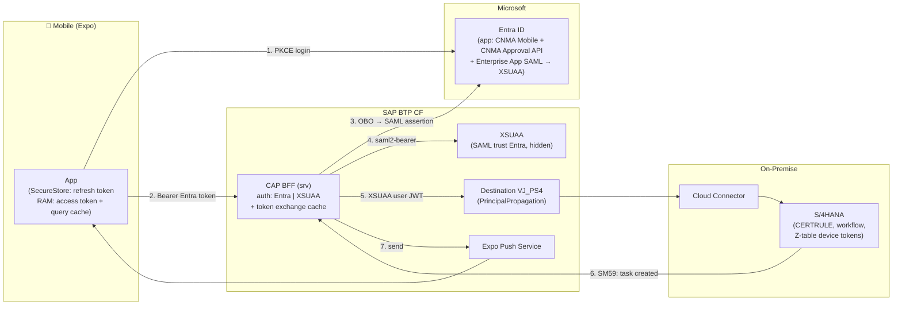
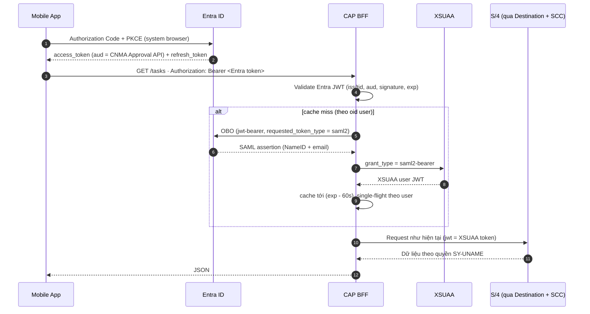
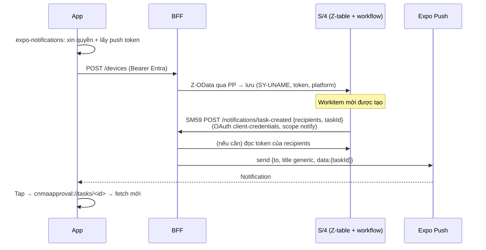

# CNMA Approval Mobile (Expo / React Native) — Architecture & Implementation Guide

> **Owner:** Project Team | **Last Updated:** 2026-10-29 | **Status:** Draft — chờ PoC auth (Phase 0)
>
> **Target stack:** Expo SDK 58 (React Native 0.88, New Architecture only) · Expo Router · `@expo/ui` · Reanimated 4 · TanStack Query v5 · CAP BFF hiện có (`srv/`)
>
> Guide này được xây theo best practices của các Expo skills: `expo-project-structure`, `expo-design-system`, `expo-router`, `expo-native-ui`, `expo-ui`, `expo-data-fetching`, `expo-animation`, `eas-app-stores`, `eas-update`, `eas-observe`. Khi code, luôn đọc docs **theo đúng SDK đã pin** (ví dụ `https://docs.expo.dev/versions/v58.0.0/...`), không đọc `latest`.

---

## 0. Các quyết định đã chốt

| Chủ đề | Quyết định | Lý do |
|---|---|---|
| Mục tiêu | App native cho mobile, giữ đăng nhập lâu, mở nhanh, UI mượt và đẹp hơn web | Web/PWA hay mất session (approuter session trong RAM, IAS token policy, iframe WorkZone) |
| Đăng nhập | **Login thẳng Microsoft Entra ID, không qua IAS** | Team không muốn quản lý IAS |
| Principal Propagation | BFF đổi token: **Entra → OBO (SAML assertion) → XSUAA `saml2-bearer` → Destination `VJ_PS4` → SCC → S/4** | Cloud Connector chỉ nhận user token do XSUAA của subaccount cấp |
| Trust BTP | Thêm **1 SAML trust với Entra**, `Available for User Logon = No`, không role collection | Chỉ để XSUAA nhận diện user Entra. Trust IAS của web giữ nguyên |
| Phân quyền | Hoàn toàn ở SAP (PP → `SY-UNAME`) | App không có role |
| Offline | **Không hỗ trợ.** Không có offline queue | Dữ liệu SAP phải mới nhất, quyết định duyệt không được gửi trễ |
| Cache dữ liệu nghiệp vụ | **Chỉ trong RAM.** Không persist chứng từ xuống máy | Yêu cầu luôn lấy dữ liệu mới |
| Biometric | Chưa làm | Chưa chứng minh được giá trị |
| Push | Có: ABAP gọi BFF qua **SM59**, device token lưu ở **Z-table trên S/4** | BTP hiện không có DB. ABAP biết người nhận |
| Attachment | Tối ưu hơn web: tải native thẳng ra file, xem bằng viewer của OS | Web đang buffer cả file ở BE và giữ blob trong RAM JS |
| Phân phối | Nội bộ: Android APK (EAS internal) · iOS TestFlight (pilot) → Unlisted App Store / Apple Business Manager | Chỉ dùng trong công ty |

---

## 1. Kiến trúc tổng thể



**Nguyên tắc:**
- Mobile gọi thẳng URL `srv-api` (route `/api/cnma/APPROVAL_SRV/tasks`), **không đi qua approuter**. Không cookie, không CSRF.
- Web giữ nguyên luồng approuter → IAS → Entra.
- Từ bước 5 trở đi, BFF chạy **y hệt hiện tại**: `SapClient` nhận một XSUAA user JWT.

---

## 2. Authentication & Session

### 2.1 Luồng token



### 2.2 Cấu hình cần có

| Nơi | Đối tượng | Cấu hình chính |
|---|---|---|
| Entra | App registration **CNMA Mobile** | Public client, redirect `cnmaapproval://auth`, xin scope `api://<api-app-id>/access_as_user` + `offline_access` |
| Entra | App registration **CNMA Approval API** | Expose scope `access_as_user`, cấp quyền cho CNMA Mobile, có client secret hoặc cert (dùng cho OBO) |
| Entra | **Enterprise App SAML → XSUAA subaccount** | Import SAML metadata của subaccount (nút *Download SAML Metadata*). NameID và attribute `email` **phải ra cùng giá trị** với claim `email` của token web hiện tại |
| BTP | Trust Configuration → **Add SAML Trust** (origin ví dụ `entra-mobile`) | `Available for User Logon = No`, `Create Shadow Users = On`, **không** bật *Default for Noninteractive Logon*, không role collection |
| BFF | Env/secret mới | `ENTRA_TENANT_ID`, `ENTRA_API_CLIENT_ID`, `ENTRA_API_CLIENT_SECRET` (hoặc cert), scope OBO tới Enterprise App SAML. Lưu bằng user-provided service, **không** để trong `mta.yaml` |

**Ảnh hưởng tới web:** không có. Trust `sap.custom` (IAS) không đổi. Vì trust mới có `Available for User Logon = No` nên XSUAA không hiện trang chọn IdP. Entity ID của Enterprise App mới (XSUAA) khác app SAML hiện có (IAS), nên không xung đột trên Entra.

### 2.3 Thay đổi ở BFF

1. **Auth middleware chọn theo issuer** (mount ở `/api/cnma/APPROVAL_SRV/tasks`, thay cho việc chỉ có `passport.authenticate('JWT')` như [server.ts](../../../srv/server.ts)):
   - `iss = https://login.microsoftonline.com/<tid>/v2.0`: đi nhánh Entra (validate qua JWKS, kiểm tra `tid` và `aud`), sau đó đổi sang XSUAA token rồi **ghi đè `Authorization`** bằng XSUAA token. Nhờ vậy `resolveIdentity()` và toàn bộ controller không phải sửa.
   - Còn lại: đi nhánh XSUAA passport như hiện tại (web).
2. **`TokenExchangeService`**: OBO → `saml2-bearer`. Cache theo `oid` (+ `tid`) tới `exp - 60s`, single-flight để nhiều request song song chỉ đổi một lần, không log token.
3. **Bắt buộc trước khi phát hành mobile:** chặn header `x-sap-user` khi `NODE_ENV=production` ([auth-helper.ts:119](../../../srv/lib/utils/auth-helper.ts:119)). Doc [02-auth-security.md](../01-architecture/02-auth-security.md) đã ghi nhận lỗ hổng này.

### 2.4 Phía mobile

- Dùng `expo-auth-session` (Authorization Code + PKCE, trình duyệt hệ thống). Nếu sau này IT bắt buộc Intune hoặc compliant device thì chuyển sang MSAL có broker.
- **Refresh token** lưu trong `expo-secure-store` (Keychain/Keystore, chỉ trên thiết bị này). **Access token chỉ giữ trong RAM.**
- Refresh **chủ động** trước khi hết hạn, mỗi lần `AppState` chuyển sang `active`, và khi gặp 401 (retry một lần, single-flight).
- **Session dài:** refresh token của Entra cho native app mặc định khoảng 90 ngày và gia hạn mỗi lần dùng. Giới hạn thực tế do Conditional Access của IT quyết định (sign-in frequency). Đây là câu hỏi duy nhất cần hỏi Microsoft admin.
- **Logout:** xoá SecureStore, `queryClient.clear()`, xoá attachment cache, huỷ đăng ký device token push.

### 2.5 PoC (Phase 0): test trước, chưa đụng Entra công ty

| Bước | Việc | Tiêu chí đạt |
|---|---|---|
| 1 | Tạo **Entra tenant miễn phí** (Azure free), tạo 3 app object ở mục 2.2 và một user test | Login PKCE bằng Postman lấy được token |
| 2 | **Subaccount QAS:** Add SAML Trust tới tenant test (`Available for User Logon = No`) | Login web QAS vẫn đi thẳng IAS, không hiện trang chọn IdP |
| 3 | Postman: OBO → SAML assertion → XSUAA `saml2-bearer` | Nhận được XSUAA JWT. Xác nhận `saml2-bearer` vẫn chạy khi trust bị ẩn |
| 4 | So sánh claim `email` / `user_name` của token mới với token web | Giống hệt nhau (tránh lệch UPN với mail) |
| 5 | **S/4 QAS:** user có email trùng user test. Deploy branch PoC của BFF lên QAS (local đang chạy `SAP_USE_DESTINATION=false` nên không test được PP) | `GET /tasks` với Bearer Entra trả đúng task của user |
| 6 | App Expo tối giản (Login + danh sách task) chạy dev build trên máy thật | Redirect, refresh, đóng/mở app vẫn còn đăng nhập |

Khi đạt cả 6 bước mới gửi Microsoft admin checklist: 3 app object, các cấu hình kèm theo, và câu hỏi về Conditional Access.

---

## 3. Cấu trúc dự án (Clean Architecture + Expo project structure)

### 3.1 Monorepo: dùng chung logic với web

`renderers/`, `mappers/`, contracts và formatters của web **không import React hay DOM**, nên tách được thành package dùng chung. Điểm coupling duy nhất cần gỡ: renderers đang import `@/pages/Inbox/utils/formatters`.

```text
cnma_approval/
├── srv/                                # CAP BFF (đã có)
├── packages/
│   └── approval-core/                  # TypeScript thuần — KHÔNG react, react-native, DOM
│       ├── contracts/                  # inbox.types.ts, inbox.contracts.ts
│       ├── renderers/                  # ObjectView.registry, core/*, objects/*/*.fields|views
│       ├── mappers/                    # taskCard.mapper, taskFilterMatchers
│       ├── formatters/                 # chuyển từ pages/Inbox/utils/formatters.ts
│       ├── query/                      # inboxKeys + các hàm cập nhật cache thuần
│       ├── api/                        # createInboxApi(http: HttpClient) — transport được inject
│       └── locales/                    # en.json, vi.json
└── app/
    ├── cnma_approval_ui/               # Web: HttpClient dùng cookie qua approuter
    └── cnma_approval_mobile/           # Mobile: HttpClient Bearer (mục 3.2)
```

- Khai báo `workspaces: ["app/*", "packages/*"]` ở root, rồi kiểm tra lại `cds build`, `mbt build` và `mta.yaml`, vì root hiện là project CAP.
- Metro (Expo) hỗ trợ monorepo sẵn, không cần cấu hình watchFolders thủ công trên các SDK gần đây.
- **Thứ tự làm:** tách `approval-core` và cho web dùng trước. Web vẫn pass `npm test` và `tsc --noEmit` thì mới bắt đầu dựng mobile.

### 3.2 Cấu trúc app mobile (theo `expo-project-structure`)

```text
app/cnma_approval_mobile/
├── assets/
├── scripts/
├── src/
│   ├── app/                              # CHỈ chứa routes (mỗi file là một route)
│   │   ├── _layout.tsx                   # Providers + Stack.Protected (auth gate)
│   │   ├── sign-in.tsx
│   │   ├── (tabs)/
│   │   │   ├── _layout.tsx               # NativeTabs: Inbox · Approved · Profile
│   │   │   ├── (inbox,approved)/
│   │   │   │   ├── _layout.tsx           # Stack dùng chung cho 2 tab (chọn screen theo segment)
│   │   │   │   ├── index.tsx             # Inbox — route "/" (app luôn phải có route khớp "/")
│   │   │   │   ├── approved.tsx
│   │   │   │   └── tasks/
│   │   │   │       ├── [id].tsx          # Task detail
│   │   │   │       └── [id]/
│   │   │   │           ├── decision.tsx  # formSheet: comment + Approve/Reject
│   │   │   │           └── attachments/[attId].tsx  # viewer modal
│   │   │   └── profile.tsx
│   │   └── filter.tsx                    # formSheet: bộ lọc
│   ├── screens/                          # Thân màn hình, route chỉ render screen
│   │   ├── inbox/
│   │   │   ├── index.tsx
│   │   │   ├── task-row.tsx              # private của Inbox
│   │   │   └── category-segments.tsx
│   │   ├── task-detail/
│   │   │   ├── index.tsx
│   │   │   ├── overview-section.tsx      # render CardDefinition từ approval-core
│   │   │   ├── line-items.tsx            # render TableDefinition thành thẻ mở rộng
│   │   │   ├── workflow-section.tsx
│   │   │   └── attachments-section.tsx
│   │   ├── decision/index.tsx
│   │   └── profile/index.tsx
│   ├── components/                       # UI dùng lại ≥ 2 màn hình
│   │   ├── themed-text.tsx
│   │   ├── button.tsx
│   │   ├── status-badge.tsx
│   │   ├── amount-text.tsx
│   │   ├── empty-state.tsx
│   │   ├── error-state.tsx
│   │   └── skeleton.tsx
│   ├── hooks/                            # Hook dùng chung: use-inbox-query, use-task-detail, use-decision...
│   ├── lib/                              # Hạ tầng (adapter): KHÔNG import UI
│   │   ├── auth/                         # entra-auth.ts, token-store.ts, session.ts
│   │   ├── api/                          # http-client.ts (expo/fetch), api-error.ts
│   │   ├── query/                        # query-client.ts, app-state-focus.ts, net-info-online.ts
│   │   ├── push/                         # register-push.ts, notification-routing.ts
│   │   └── files/                        # attachment-cache.ts
│   ├── utils/                            # helper thuần + test đặt cạnh (format-*.ts / *.test.ts)
│   ├── theme/                            # Design tokens (mục 4)
│   └── constants.ts
├── app.config.ts                         # biến thể QAS/PRD (mục 10)
├── eas.json
└── package.json
```

**Quy tắc phụ thuộc** (enforce bằng ESLint `no-restricted-imports` hoặc dependency-cruiser):

```
app/ (routes) → screens/ → components/ + hooks/ → lib/ + @cnma/approval-core
                                                theme/ ← components/, screens/
```
- `src/app/` chỉ đọc params và render screen, không chứa logic.
- `screens/*` không import lẫn nhau. Phần dùng chung đưa vào `components/` hoặc `hooks/` theo quy tắc "xuất hiện ở ≥ 2 màn hình mới promote".
- `lib/` không import `components/`, `screens/` hay `theme/`.
- `approval-core` không import `react`, `react-native` hay `expo-*`.
- Đặt tên file theo kebab-case. Style để cuối file. Test đặt cạnh file được test.

---

## 4. Design System (theo `expo-design-system`)

### 4.1 Nguyên tắc
- **Theo ngôn ngữ của từng nền tảng:** HIG trên iOS, Material 3 trên Android. Không bê Fiori của web sang. Thương hiệu thể hiện qua **một màu accent**, không qua việc tự vẽ lại control.
- **Một nguồn token duy nhất:** `src/theme/`. Không hardcode hex, font size hay spacing ngoài thư mục này.
- **Không dùng NativeWind.** Dùng inline style kết hợp token, đúng khuyến nghị của `expo-native-ui`, và tránh thêm một "hệ thống thứ hai".

### 4.2 Tokens

```text
src/theme/
  colors.ts      # semantic (Color từ expo-router) + brand pairs
  spacing.ts     # 4-pt grid: xs 4 · sm 8 · md 16 · lg 24 · xl 32 · xxl 48 (+12 nếu lặp lại nhiều)
  typography.ts  # ramp theo Apple text styles: largeTitle · title · headline · body · subhead · caption
  radius.ts      # sm 8 · md 12 · lg 16 · full — luôn kèm borderCurve: 'continuous'
  shadows.ts     # boxShadow: card · raised · overlay (không dùng elevation/shadow* legacy)
  motion.ts      # fast 150 · base 250 · slow 400
  index.ts
```

**Màu:**
- Nền, chữ, separator: dùng **semantic** (`Color.ios.*` / `Color.android.dynamic.*`) để tự thích ứng light/dark và cài đặt accessibility.
- **Brand pairs (light/dark)** chỉ gồm 3 nhóm: `accent` (`#cc0000` lấy từ `--color-brand` trong [theme.css](../../../app/cnma_approval_ui/src/styles/theme.css), kèm biến thể sáng hơn cho dark mode), `approve` (xanh) và `reject` (đỏ), cùng `onAccent`.
- Brand color được đọc bằng hook (`useBrandColors()`), **không** import vào file token tĩnh. Không truyền `Color`/`PlatformColor` vào style của Reanimated.

**Chữ:** mọi văn bản đi qua `ThemedText variant="…"`. Giữ Dynamic Type (`allowFontScaling` mặc định bật). Số tiền dùng `fontVariant: ['tabular-nums']` và `selectable`.

### 4.3 Hợp đồng component
- Mỗi primitive có: `variant` (primary · secondary · ghost · destructive), `size` (sm · md), state (pressed · disabled · loading), `style` được merge **cuối cùng**, và đủ accessibility (role, state, label).
- Dùng **children thay vì thêm nhiều prop nội dung**. Không bọc lại control native (`Switch`, picker, header của stack, `@expo/ui`) chỉ để "đi qua design system".

### 4.4 Tránh "native slop" (rà khi review)

| Lỗi | Thay bằng |
|---|---|
| Modal tự vẽ ở giữa màn hình để nhập comment hoặc chọn filter | Route `formSheet` |
| Mọi thứ đều là card có bóng | Danh sách nhóm theo nền + hairline. Task row là row, không phải card nổi |
| Icon emoji | SF Symbols (`expo-symbols`) trên iOS, Material Symbols trên Android |
| Spinner toàn màn hình | Skeleton có hình giống nội dung thật + 4 trạng thái (mục 6.3) |
| Tiêu đề tự vẽ bằng `<Text>` | Tiêu đề của stack (`Stack.Title`, large title) |

---

## 5. Navigation & Native UI

### 5.1 Routing (theo `expo-router`)

| Màn hình | Cách trình bày | Ghi chú |
|---|---|---|
| Tabs Inbox · Approved · Profile | **NativeTabs** (tab bar thật của OS, đã stable từ SDK 58; lấy import path theo docs của SDK đã pin) | Badge số task trên tab Inbox. Đổi tab **không animation** |
| Inbox / Approved | Native Stack, `headerLargeTitleEnabled` (iOS) | `Stack.SearchBar` để tìm kiếm thay cho ô search tự làm |
| Task detail `tasks/[id]` | Push trên stack, `headerLargeTitleEnabled: false` | Vuốt cạnh để back là hành vi native có sẵn |
| Quyết định `tasks/[id]/decision` | `presentation: 'formSheet'`, `sheetAllowedDetents: [0.5, 1]`, `sheetGrabberVisible` | Sheet thật của OS. iOS 26+ có liquid glass khi nền trong suốt |
| Bộ lọc `filter` | `formSheet` | Bên trong dùng `FieldGroup`, `Picker` và datetimepicker của `@expo/ui` |
| Xem attachment | `presentation: 'modal'` | — |
| Auth gate | `Stack.Protected guard={isSignedIn}` trong root `_layout` | Giữ splash cho tới khi đọc xong SecureStore (gate theo hydration) |

- **Link previews và context menu (iOS):** trên task row dùng `Link.Preview` (peek vào detail) và `Link.Menu` (Mở, Chia sẻ số chứng từ, Sao chép). **Không** đặt Approve hay Reject trong context menu, vì mọi quyết định phải đi qua sheet xác nhận.
- **Deep link** `cnmaapproval://tasks/<id>` (dùng cho push): màn đích **luôn fetch lại** và để BFF/SAP kiểm tra quyền, không tin dữ liệu đi kèm notification.
- Từ SDK 56+, không import `@react-navigation/*` trực tiếp, dùng `expo-router/react-navigation`.

### 5.2 Chọn component (ưu tiên `@expo/ui` trước)

| Nhu cầu | Dùng |
|---|---|
| Inbox (dài, phân trang) và line items nhiều dòng | **FlashList** (ảo hoá, tái sử dụng cell). `@expo/ui` `List` **không** ảo hoá |
| Overview fields của chứng từ (khoảng 6–12 dòng cố định) | `@expo/ui` `List` + `ListItem` hoặc `FieldGroup` (hàng native kiểu Settings) |
| Picker, Switch, Menu, Slider, datetimepicker | `@expo/ui` |
| Sheet gắn với một route | Router `formSheet`. Sheet nội bộ trong màn hình thì dùng `@expo/ui` `BottomSheet`. **Không** dùng `@gorhom/bottom-sheet` |
| Ảnh, avatar | `expo-image` |
| Icon | `expo-symbols` (`SymbolView`) + Material cho Android |
| Safe area | Trên ScrollView/FlatList/FlashList đặt `contentInsetAdjustmentBehavior="automatic"`, không dùng `SafeAreaView` |
| Phím ảo (ô comment) | `react-native-keyboard-controller` (`KeyboardProvider` ở root) |

### 5.3 Dùng lại renderers cho Task Detail
- `resolveObjectViewDefinition()` của `approval-core` trả về `CardDefinition` và `TableDefinition`. Mobile chỉ viết lớp hiển thị:
  - `overview-section.tsx`: field thường dùng `ListItem`. Field có `isLongText` (HeaderNote, Purpose…) đưa xuống một section riêng có `<Text selectable>`.
  - `line-items.tsx`: dạng **thẻ mở rộng**. Phần thu gọn hiện 3–4 cột ưu tiên đầu tiên của `table.columns`. Bấm vào thì mở ra lưới 2 cột cho các cột còn lại. Cấu hình cột lấy theo `excludeColumns` / thứ tự sẵn có trong `[type].views.ts`.
- Tính view model bằng `useMemo` theo `detail.businessObject`, **không** tính lại trong mỗi lần render cell.

---

## 6. Data Layer (theo `expo-data-fetching`)

### 6.1 HTTP client
- Dùng **`expo/fetch`**, không dùng axios. `lib/api/http-client.ts` cài đặt interface `HttpClient` của `approval-core`:
  - Gắn `Authorization: Bearer <access token>` lấy từ `lib/auth/session.ts`.
  - Gặp 401 thì refresh một lần (single-flight), retry, và nếu vẫn lỗi thì đăng xuất về `sign-in`.
  - Ném `ApiError { status, code, message }` có kiểu. Lỗi mạng dùng `code = NETWORK_ERROR`.
  - Truyền `signal` của TanStack Query để huỷ request (ví dụ khi gõ search).
- Base URL theo biến thể build: `EXPO_PUBLIC_API_URL` (QAS/PRD). Không đưa secret nào vào `EXPO_PUBLIC_*`.

### 6.2 TanStack Query

| Query | `staleTime` | Ghi chú |
|---|---|---|
| Inbox list (theo category, phân trang) | 0–30s | **Lazy theo category**: chỉ query category đang mở (`enabled`). Refetch khi app quay lại foreground |
| Category counts | 30s | Badge tab + segment |
| Task detail | 0s, `gcTime` 5 phút | Luôn revalidate khi mở. `decisionOptions` **bắt buộc mới** trước khi cho bấm Duyệt |
| Comments / attachments metadata | 30s | — |

- Nối `focusManager` với `AppState` và `onlineManager` với `@react-native-community/netinfo` (`lib/query/`). Khi app ở nền thì mọi refetch dừng.
- Query keys và hàm cập nhật cache lấy từ `approval-core/query` (dùng chung với web).
- **Không** dùng persister, **không** lưu dữ liệu nghiệp vụ xuống đĩa.
- **Prefetch detail khi `onPressIn`** của task row (khoảng 100–200ms trước khi điều hướng). Rẻ và chính xác hơn prefetch theo viewport.

### 6.3 Bốn trạng thái của mỗi màn hình
- **Loading:** skeleton có hình giống nội dung (lần tải đầu, `isLoading`). Tải nền (`isFetching`) không chặn UI.
- **Error:** có cache thì vẫn hiện dữ liệu cũ kèm lỗi inline và nút retry. Không có cache thì hiện `ErrorState` kèm retry.
- **Empty:** chỉ hiện sau khi đã resolve với 0 item. "Không còn task nào cần duyệt" khác với "Không có kết quả cho bộ lọc", và trường hợp sau có nút "Xoá bộ lọc".
- **Offline:** query ở trạng thái `paused` thì hiện banner offline, **tắt nút Duyệt/Từ chối**.

### 6.4 Mở app nhanh mà dữ liệu vẫn mới
1. Splash chỉ chờ **đọc refresh token từ SecureStore** (vài ms), không chờ mạng.
2. Ngay ở module scope (trước khi React render): bắt đầu refresh access token, sau đó `prefetchInfiniteQuery` trang đầu inbox và category counts.
3. Render ngay khung giao diện: tab bar, header, skeleton danh sách.
4. Dữ liệu về thì skeleton chuyển sang nội dung. Thời gian thật phụ thuộc hoàn toàn vào **API list của BFF**, nên đây là endpoint cần tối ưu nhất (mục 8.3).

### 6.5 Quyết định Approve/Reject
- Chỉ đi qua **decision sheet**. Nút submit bị khoá khi đang pending để tránh gửi lặp. Lỗi thì **giữ nguyên comment đã nhập**.
- **Optimistic removal:** ngay khi submit, gỡ task khỏi list và giảm counts. Lỗi (mạng, task bị khoá, đã được xử lý bởi người khác) thì **rollback** và hiện thông báo rõ ràng.
- Thành công: haptic `Success`, đóng sheet, ở detail thì quay về list (hoặc sang task kế tiếp). Sau đó invalidate counts và list.
- **Không có Undo, không có offline queue.** Decision trên SAP không đảo ngược được.

---

## 7. Animation & Interaction (theo `expo-animation`)

### 7.1 Gate trước khi animate

| Tương tác | Tần suất | Quyết định |
|---|---|---|
| Đổi tab, đổi category, cuộn | Rất cao | **Không animation**, chỉ dùng hành vi mặc định của nền tảng |
| Nhấn row/nút | Cao | Phản hồi khi nhấn: `scale 0.97` trong 100–150ms (nút). Row full-width thì đổi màu nền, không scale |
| Push detail, mở sheet, mở modal | Thỉnh thoảng | **Animation native của stack hoặc sheet**, không tự viết lại bằng JS |
| Swipe trên task row | Thỉnh thoảng | Gesture + spring (7.2) |
| Duyệt thành công | Hiếm | Item rời khỏi list + haptic Success. Đây là chỗ dành cho cảm giác "đã" |

### 7.2 Công cụ và quy tắc
- **Reanimated 4 + react-native-worklets + Gesture Handler** (`GestureHandlerRootView` ở root). Không dùng core `Animated`, không dùng `PanResponder`.
- Trạng thái chỉ có 2 giá trị (press, toggle) thì dùng **Reanimated CSS transition**. Gesture và scroll thì dùng `useSharedValue` + `Gesture` + `useAnimatedStyle`.
- **Chỉ animate `transform` và `opacity`.** Không animate `height`, `margin` hay `elevation`.
- Có ngón tay thì dùng **spring** (`{ duration: 400, dampingRatio: 0.8, velocity }`). Không có thì dùng ease-out `Easing.bezier(0.23, 1, 0.32, 1)`. Không dùng `ease-in`.
- **Không `setState` trong gesture/scroll handler.** Dùng `scheduleOnRN` (thay cho `runOnJS`) chỉ trong `onEnd` hoặc khi vượt ngưỡng. Đọc/ghi shared value bằng `.get()` / `.set()`.
- **Swipe task row:** vuốt phải hiện nền Approve, vuốt trái hiện nền Reject. Vượt ngưỡng (theo khoảng cách **hoặc** vận tốc) thì kèm haptic Light đúng lúc chạm ngưỡng. Thả tay ra **mở decision sheet** đã chọn sẵn hành động, **không** duyệt ngay.
- **Item rời list:** không gắn `entering`/`exiting` cho row của list ảo hoá. Animate container hoặc dùng layout transition mà list hỗ trợ, và kiểm tra trên FlashList v2.
- **Header thu gọn:** dùng `headerLargeTitleEnabled` của native stack, không tự viết scroll worklet.

### 7.3 Haptics (`expo-haptics`)

| Khoảnh khắc | Gọi |
|---|---|
| Đổi segment category, chọn chip filter | `selectionAsync()` |
| Swipe vượt ngưỡng, sheet bắt vào detent | `impactAsync(Light)` |
| Duyệt / từ chối thành công hoặc thất bại | `notificationAsync(Success / Error)` |

Mỗi hành động chỉ một haptic, xảy ra cùng frame với hiệu ứng hình ảnh, và không bao giờ là phản hồi duy nhất.

### 7.4 Accessibility & 120fps
- **Reduced motion đi kèm ngay từ đầu:** `useReducedMotion()` / `ReduceMotion.System`. Khi bật thì bỏ translate, scale và overshoot, chỉ giữ opacity.
- Kiểm tra `CADisableMinimumFrameDurationOnPhone: true` trong `ios.infoPlist` (ProMotion 120Hz).
- **Đánh giá độ mượt trên bản release, chạy trên máy Android chậm nhất được hỗ trợ.** Expo Go và simulator không tính.

---

## 8. Performance

### 8.1 Budget (đo bằng EAS Observe + Flashlight)

| Chỉ số | Mục tiêu |
|---|---|
| Cold start → khung giao diện hiển thị | < 1s |
| Cold start → trang đầu inbox có dữ liệu (4G) | < 2.5s (phụ thuộc BFF → S/4) |
| Cuộn inbox | 60fps ổn định trên Android tầm trung, 120fps trên ProMotion |
| Mở task detail (đã prefetch khi press-in) | Overview hiện < 300ms |

### 8.2 Kỹ thuật phía app
- New Architecture, Hermes và **React Compiler** đều bật (mặc định trên SDK mới).
- Cell của FlashList nhẹ: không tính toán nặng, không tạo object style mới trong render, ảnh dùng `expo-image` có cache.
- View model từ renderers tính một lần bằng `useMemo`.
- Không tải trước dữ liệu của tab chưa mở.
- Dùng `expo-observe` để đo cold/warm launch, TTI và thời gian render theo route (skill `eas-observe`).

### 8.3 Kỹ thuật phía BFF (vì không có snapshot persist)
- Endpoint list là critical path: chỉ trả các field tóm tắt cần cho row, phân trang `top=20`.
- Cache token đổi theo user (mục 2.3) để không cộng thêm độ trễ vào mỗi request.
- Nếu CF chạy nhiều instance: `instanceCache` của [inbox-processor.ts](../../../srv/lib/processors/inbox-processor.ts) bị miss chéo giữa các instance. Cân nhắc Redis hoặc sticky session.
- Nếu muốn giảm bước dò loại đơn khi cache miss: **chỉ** dùng hint (`objectType`) để bỏ qua bước detect, vẫn giữ bước kiểm tra task nằm trong worklist của user ([object-type-resolver.ts:38](../../../srv/lib/processors/object-type-resolver.ts:38)), để tránh IDOR.

---

## 9. Attachments (tối ưu so với web)

**Hiện trạng web:** [streamAttachment](../../../srv/controllers/inbox-controller.ts:1047) đọc cả file vào buffer để đoán loại file. Nếu thiếu `documentId`/`objectType` thì gọi lại `getTaskDetail` cho mỗi lần tải. Web nhận blob vào RAM của JS.

| Tầng | Cách làm |
|---|---|
| BFF | Mobile **luôn gửi** `documentId` + `objectType` để bỏ bước tính lại detail. Trả `Content-Length`, `ETag`, `Cache-Control: private`. Stream khi có thể |
| Danh sách | Hiện tên, loại file và dung lượng trước khi tải. Ảnh nhỏ thì hiện thumbnail |
| Tải | Dùng API `File`/`Directory` mới của `expo-file-system` để **tải ở tầng native thẳng ra file** (có header Authorization), có thanh tiến trình. **Không** đi qua base64 hay blob trong JS |
| Cache | `Paths.cache/attachments/<attachmentId>`, LRU khoảng 100MB, **xoá khi logout**, không backup |
| Xem | iOS: QuickLook. Android: intent `ACTION_VIEW` với content URI. Ảnh dùng `expo-image` có pinch-zoom. Chỉ chia sẻ khi người dùng bấm Share |
| Prefetch | Khi mở tab Files và đang dùng Wi-Fi: tải trước file dưới 2MB |

---

## 10. Push Notifications



- **Device registry ở Z-table:** bản ghi được ghi qua PP nên chủ sở hữu là đúng `SY-UNAME`. BTP vẫn stateless. Logout thì gọi `DELETE /devices/<token>`.
- **Endpoint SM59** tách biệt khỏi API của user: dùng OAuth client-credentials với scope riêng, có idempotency key theo `taskId`, có rate limit.
- **Payload tối thiểu:** "Bạn có yêu cầu duyệt mới" kèm `taskId`. Không ghi số tiền, vendor hay nội dung chứng từ (tránh lộ trên màn hình khoá).
- Badge của app lấy từ category counts sau khi mở app (không tin số trong push).
- **Remote push không chạy trong Expo Go trên Android**, nên phải dùng development build (`expo-dev-client`).
- `notification-controller.ts` hiện có là thông báo kiểu BTP/WorkZone, không dùng lại cho push mobile.

---

## 11. Security Checklist

- [ ] BFF validate đủ issuer, `tid`, `aud`, chữ ký và `exp` của token Entra. Chấp nhận đúng một tenant.
- [ ] `x-sap-user` bị chặn ở production. App mobile không có switcher giả lập user nào.
- [ ] Refresh token chỉ nằm trong SecureStore (Keychain/Keystore, chỉ thiết bị này). Access token chỉ trong RAM. Không log token (kể cả Sentry/Observe).
- [ ] Không persist dữ liệu nghiệp vụ. Attachment cache bị xoá khi logout.
- [ ] Deep link chỉ mang id, màn đích luôn fetch lại.
- [ ] Push payload không chứa dữ liệu nhạy cảm.
- [ ] Làm mờ nội dung khi app hiện trong app switcher.
- [ ] Endpoint SM59 dùng client-credentials với scope riêng.
- [ ] Secret của Entra API (dùng cho OBO) chỉ nằm trên BFF (user-provided service), không bao giờ đưa vào app.
- [ ] Chưa làm certificate pinning (cert BTP thay định kỳ, rủi ro sập app). Đánh giá lại sau.

---

## 12. Build, Phân phối & Cập nhật (EAS)

| Hạng mục | Cách làm |
|---|---|
| Biến thể | `app.config.ts` đọc `APP_VARIANT` (`qas` / `prd`): bundle id có hậu tố (`…mobile.qas`), tên app, icon và `EXPO_PUBLIC_API_URL` riêng, để cài song song 2 bản trên một máy |
| `eas.json` profiles | `development` (dev client, internal) · `preview` (QAS, internal) · `production` (PRD) · `appVersionSource: "remote"`, `autoIncrement` |
| Android | APK `distribution: internal`, phát qua link hoặc QR nội bộ (hoặc MDM nếu có) |
| iOS | **TestFlight** cho pilot (mỗi build hết hạn sau 90 ngày) → **Unlisted App Store** hoặc **Custom App qua Apple Business Manager** cho production. Cả hai đều qua Apple review |
| Apple review | Chuẩn bị **tài khoản demo**: user Entra map tới user S/4 PRD có vài task vô hại |
| OTA | **EAS Update**: channel `preview` / `production`, `runtimeVersion` theo policy `fingerprint`. Chỉ đẩy thay đổi JS/asset. Đổi native thì build lại |
| CI | EAS Workflows: PR → build preview. Merge vào main → update `preview`. Tag → build + submit production |

---

## 13. Testing

| Tầng | Công cụ | Phạm vi |
|---|---|---|
| `approval-core` | Vitest (dùng chung với web) | renderers, mappers, formatters, hàm cập nhật cache, query keys |
| Component / screen mobile | `jest-expo` + React Native Testing Library + MSW | 4 trạng thái, decision sheet (submit, lỗi, retry giữ comment), filter |
| E2E | Maestro (YAML) | Login (tenant test) → mở task → swipe → sheet → Approve → task biến mất |
| Hiệu năng | EAS Observe, Flashlight (Android) | Budget ở mục 8.1, chạy trên bản release, máy thật |

---

## 14. Roadmap

| Phase | Nội dung | Kết quả |
|---|---|---|
| **0 — PoC Auth** | Mục 2.5: Entra tenant test → OBO → XSUAA → PP trên QAS + app tối giản. Chặn `x-sap-user` | Chứng minh PP chạy với token Entra. Có checklist cho Microsoft admin |
| **1 — Shared core** | Tách `packages/approval-core` và cho web dùng nó | Web vẫn pass `npm test` và `tsc --noEmit` |
| **2 — MVP** | Scaffold Expo (`npx create-expo-app@latest`), theme, routes, Inbox (lazy theo category), Detail (renderers), Decision sheet, Comments, Attachments (bản đơn giản), 4 trạng thái | Pilot qua TestFlight / APK |
| **3 — Push + Attachments tối ưu** | Z-table + SM59 + Expo Push. Tải/xem attachment native, BFF ETag/stream | Push end-to-end trên QAS |
| **4 — Polish** | Swipe actions, `Link.Preview`/`Link.Menu`, haptics, reduced motion, đạt budget hiệu năng, iPad layout (nếu bật `supportsTablet`) | Release production |

---

## 15. Việc cần xác minh (mở)

1. `saml2-bearer` có chạy khi trust Entra đặt `Available for User Logon = No` không (Phase 0, bước 3).
2. Claim `email` của token qua chuỗi mới có trùng token web không (Phase 0, bước 4).
3. Conditional Access cho Enterprise App SAML của XSUAA có giới hạn sign-in frequency hay chặn trình duyệt mobile không (hỏi Microsoft admin sau PoC).
4. Cloud Connector có cần đổi gì không (dự kiến là không, vì issuer vẫn là XSUAA).
5. Team ABAP: event linkage khi tạo workitem, định nghĩa SM59 và Z-table/Z-OData cho device token.
6. FlashList v2 có hỗ trợ layout transition khi gỡ item không. Nếu không thì chọn phương án thay thế.
7. Root `workspaces` có làm ảnh hưởng `cds build` / `mbt build` không.

---

## Tài liệu tham khảo
- Kiến trúc auth hiện tại: [02-auth-security.md](../01-architecture/02-auth-security.md), [05-ias-entra-sso-principal-propagation.md](../01-architecture/05-ias-entra-sso-principal-propagation.md)
- Renderer khai báo: [04-config-driven-mapping.md](../01-architecture/04-config-driven-mapping.md)
- Entra ↔ SAP PP: [Microsoft Learn](https://learn.microsoft.com/en-us/azure/sap/microsoft-ai/copilot-studio/sso-entra-id-sap-cloud-identity-services) · [SAML bearer + Entra OBO](https://community.sap.com/t5/technology-blog-posts-by-sap/demystifying-the-oauth2-saml-bearer-assertion-usage-in-sap-integration/ba-p/14177915) · [Azure AD → on-prem PP](https://blogs.sap.com/2021/07/12/principal-propagation-between-azure-ad-and-an-on-premise-sap-system-through-sap-api-management) · [Postman sample](https://github.com/azuredevcollege/SAP/blob/master/sap-oauth-saml-flow/PostmanSetup/README.md)
- BTP trust SAML trực tiếp: [SAP docs](https://github.com/SAP-docs/btp-cloud-platform/blob/main/docs/50-administration-and-ops/establish-trust-and-federation-with-uaa-using-any-saml-identity-provider-2ce3938.md)
- Expo: [SDK 58 changelog](https://expo.dev/changelog/sdk-58) · [Folder structure best practices](https://expo.dev/blog/expo-app-folder-structure-best-practices)
