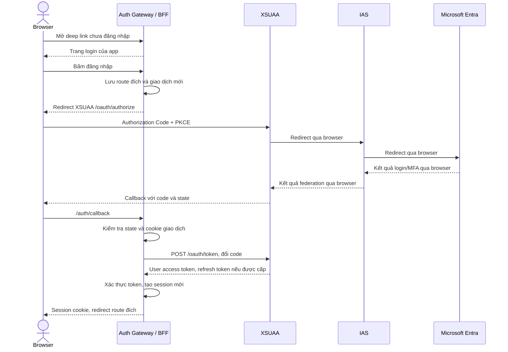

# Custom Login & Recovery — IAS + XSUAA

**Mục đích:** tài liệu giao cho coding agent kiểm tra codebase và triển khai. Đây là thiết kế mục tiêu; chưa xác nhận cấu trúc hoặc phiên bản dependency trong repo.

## 1. Mục tiêu và ràng buộc

- App chủ động hiển thị trang login, quản lý session và phục hồi khi login bị gián đoạn.
- Giữ chuỗi xác thực **XSUAA → IAS → Microsoft Entra**, MFA, role/scope và principal propagation hiện tại.
- Login bắt đầu ở **XSUAA** để nhận **XSUAA user access token**. Không chuyển sang đăng nhập trực tiếp IAS/Entra.
- Trang app có nút “Đăng nhập bằng Microsoft”; mật khẩu và MFA vẫn thực hiện trên Microsoft.
- Thông thường không cần đổi Entra/IAS khi trust hiện tại giữ nguyên; callback BFF mới được đăng ký tại XSUAA.
- Không coi đây là cách sửa `ERR_SSL_PROTOCOL_ERROR`. Lỗi TLS và lỗi giao dịch login sau refresh là hai vấn đề cần kiểm chứng riêng; “mất browser history” chưa phải nguyên nhân đã xác nhận.

## 2. Agent kiểm tra codebase trước, rồi implement

Đọc `AGENTS.md` và xác định:

1. Entry point thực tế: standalone AppRouter hay Work Zone/iframe; React router, deep link và PWA start URL.
2. `mta.yaml`, `xs-app.json`, `xs-security.json`, XSUAA bindings, redirect URI, AppRouter version/extensions, middleware/session store hiện có.
3. CAP kiểm tra JWT/role thế nào; user JWT đi vào Destination/Connectivity/SAP ở đâu.
4. Callback/error handler, timeout, cookie, số instance, session stickiness/persistence và các log lỗi hiện có. Không in secrets hoặc token khi kiểm tra.

Ghi ngắn các file liên quan và phương án đã chọn, sau đó triển khai trong phạm vi task. Không tự đổi trust, Entra Enterprise Application hoặc workflow nghiệp vụ.

**Target:** một auth gateway/BFF quản lý OAuth callback và session cho entry point standalone. Ưu tiên tái sử dụng module/thư viện hiện có; có thể mở rộng AppRouter nếu đáp ứng cùng behavior. Không tạo hai lớp login/session độc lập nối tiếp nhau. Nếu còn Work Zone, bảo toàn entry point hiện tại và kiểm tra riêng ngữ cảnh iframe.

## 3. Flow đăng nhập

Các bước federation bên dưới diễn ra qua browser redirect; BFF chỉ đổi code với XSUAA ở phía server.

## 4. API và token

Tên endpoint là đề xuất; thích ứng naming của repo.

| Endpoint | Behavior |
|---|---|
| `GET /login` | Public; nút Microsoft và thông báo phục hồi bằng ngôn ngữ dễ hiểu. |
| `GET /auth/login` | Tạo giao dịch mới, lưu route nội bộ hợp lệ, redirect XSUAA. |
| `GET /auth/callback` | Kiểm tra giao dịch, đổi code một lần, tạo session; lỗi thì về trang phục hồi. |
| `GET /auth/session` | Trả trạng thái và thông tin user tối thiểu; không trả token. |
| `/api/*` | Kiểm tra session, lấy access token còn hạn và forward tới CAP. API chưa login trả JSON 401, không trả HTML login. |
| `POST /auth/logout` | Hủy session/token phía app và cookie; giữ hoặc tích hợp SSO logout theo behavior repo hiện tại. |

| Chặng | Danh tính sử dụng |
|---|---|
| Browser → BFF | Cookie session; React không lưu token trong localStorage. |
| BFF → CAP | `Authorization: Bearer <XSUAA user access token>`; CAP vẫn kiểm tra JWT và quyền. |
| CAP → Destination/Connectivity | Giữ user JWT và flow principal propagation/SDK hiện có. |
| Cloud Connector → SAP on-premise | Certificate ngắn hạn và mapping SAP user theo cấu hình hiện tại. |

Bind gateway vào XSUAA phù hợp với CAP; kiểm tra issuer, audience và scope thay vì mặc định mọi XSUAA token đều hợp lệ. Không thay user token bằng client-credentials token.

## 5. Recovery sau lỗi mạng hoặc callback cũ

1. Lưu **route đích** độc lập với giao dịch OAuth; dùng continuation ID/cookie được bảo vệ, không đưa code/token vào return URL. Route được ràng buộc với browser; chỉ cho phép đường dẫn nội bộ, loại `//host` và URL ngoài origin.
2. Callback thiếu/sai/hết hạn `state`, code đã dùng hoặc cookie giao dịch mất: không tạo session; hiển thị “Phiên đăng nhập bị gián đoạn. Vui lòng đăng nhập lại”.
3. Nút “Đăng nhập lại” tạo **state/PKCE/giao dịch mới**; không refresh hoặc replay callback cũ. Giữ route đích nếu continuation còn hợp lệ; thiếu thì về trang chủ.
4. Khi session còn hợp lệ, mở lại app đi thẳng vào route hợp lệ, không ép login lại.
5. Nếu access token hết hạn, refresh phía server theo policy; refresh bị từ chối thì kết thúc session và yêu cầu login mới. Phân biệt với 403 thiếu quyền; không tự replay thao tác ghi dữ liệu.

**Giới hạn:** khi browser còn đứng trên trang lỗi TLS hoặc lỗi IAS, code app không điều khiển được trang đó. Sau đổi Wi-Fi → 4G, user cần mở lại link app để khởi động luồng mới. Không hứa tự recover ngay trên trang IAS. Phiên SSO hiện có có thể giúp login nhanh hơn, tùy policy.

## 6. Yêu cầu triển khai

- Dùng thư viện OAuth/SAP được duy trì, phù hợp phiên bản repo; Authorization Code + PKCE S256 và kiểm tra state gắn với browser. Kiểm tra nonce nếu dùng OIDC ID token.
- Tách session đăng nhập và giao dịch OAuth: TTL rõ ràng, code/state chỉ dùng một lần, hỗ trợ nhiều lần thử/tab không ghi đè nhầm giao dịch.
- Cookie `HttpOnly`, `Secure`; chọn `SameSite` theo callback/context thực tế. Rotate session ID sau login; bảo vệ CSRF cho API dùng cookie, bao gồm logout.
- Token và client secret chỉ ở server; dùng bindings/config hiện tại. Session/token store dùng chung và được bảo vệ khi nhiều instance; tái sử dụng persistence sẵn có nếu phù hợp.
- Public login/callback/recovery phải truy cập được trước login, kể cả khi có AppRouter phía trước. Đăng ký callback HTTPS chính xác trong XSUAA `oauth2-configuration.redirect-uris`.
- Log correlation ID, bước login và loại lỗi; redact URL query, code, token, cookie và dữ liệu MFA. Không log raw state/session ID.
- Giữ timeout, refresh và logout nhất quán; tránh retry/redirect vô hạn. Không tắt kiểm tra TLS, state hoặc JWT để vượt lỗi.

## 7. Tiêu chí nghiệm thu

- [ ] Login mới qua XSUAA → IAS → Microsoft/MFA thành công; CAP nhận đúng user và quyền.
- [ ] Deep link được khôi phục; URL ngoài origin bị từ chối.
- [ ] Login bị gián đoạn rồi mở lại app: có đường đăng nhập mới, không kẹt callback cũ.
- [ ] State sai/hết hạn, cookie mất và callback/code bị replay: không cấp session; recovery rõ ràng.
- [ ] Refresh token thành công hoặc hết hiệu lực được xử lý đúng; không biến 403 thành vòng login.
- [ ] Principal propagation gọi SAP bằng đúng user; API ghi không tự thực thi hai lần.
- [ ] Logout xóa session app; không lộ token/secret trong browser, response hoặc log.
- [ ] Multi-instance và các entry point/PWA/Work Zone đang dùng được kiểm tra phù hợp.

Test tự động tập trung vào state/callback, return URL, session và refresh. Test thủ công trên mobile cho login/MFA và ngắt mạng. Mô phỏng lỗi TLS chỉ xác nhận UI lỗi mạng, không chứng minh nguyên nhân sự cố thực tế.

**Agent bàn giao:** thay đổi code/config, cách deploy, kết quả test, giới hạn còn lại và rollback. Tách việc cần thao tác trên BTP khỏi code; không yêu cầu chỉnh Entra khi trust không đổi.

## Tham khảo

- [XSUAA Authorization Code và Refresh Token flow](https://sap.github.io/cloud-sdk/docs/java/guides/cloud-foundry-xsuaa-service)
- [XSUAA security descriptor và redirect URI](https://help.sap.com/docs/btp/sap-business-technology-platform/application-security-descriptor-configuration-syntax)
- [SAP Cloud SDK — On-Premise Connectivity](https://sap.github.io/cloud-sdk/docs/js/features/connectivity/on-premise)
- Nguồn dự án: `sap_btp_entra_id_integration_knowledge_base(1).md` do user cung cấp.
